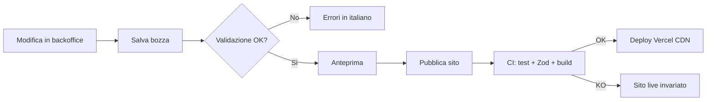
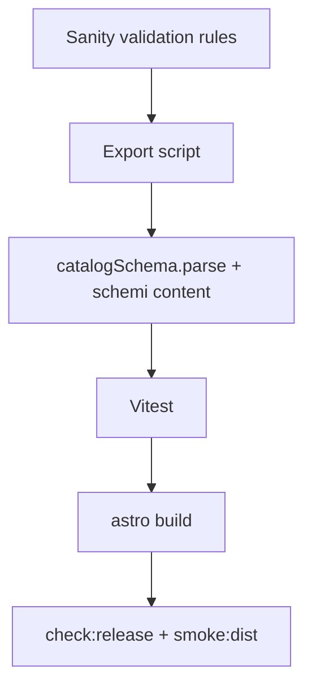

# PLAN-BACKOFFICE — Backoffice contenuti e catalogo

**Repository:** `gramazio-tabitha` (root verificata: workspace del progetto Astro)  
**Cliente:** Azienda Agricola Gramazio Tabitha — Carpino (FG), Gargano  
**Documento:** piano tecnico di implementazione backoffice (solo pianificazione; nessuna implementazione in questa fase)  
**Data analisi:** 2026-10-31  
**Stack verificato:** Astro `^7.3.8`, React `^19.3.0`, TypeScript strict, Zod `^4.6.5`, Vitest, deploy target Vercel (`vercel.json`), CI GitHub Actions (`.github/workflows/ci.yml`)

---

## 1. Executive summary

### Problema attuale

Il sito v1 è **statico ad alte prestazioni** senza CMS né pannello admin (`README.md`, gap **ADM-001** in `PLAN.md`). Catalogo, testi editoriali, contatti commerciali, hero, FAQ e gran parte dei media sono **versionati nel repository** (`src/domain/catalog/products.data.ts`, `src/content/*.ts`, `src/config/site.config.ts`, `src/config/home.media.ts`, testi inline in `src/pages/*.astro`, asset in `public/images/`). Ogni aggiornamento ordinario (prezzo, nuovo prodotto stagionale, foto, FAQ, numero WhatsApp) richiede **competenza da sviluppatore** o un maintainer guidato da `docs/catalog-management.md`, con commit, build e deploy.

### Obiettivo del backoffice

Consentire al titolare o a un collaboratore con competenze digitali medio-basse di gestire **autonomamente** catalogo, contenuti principali, contatti, media ordinari e pubblicazione, **senza** TypeScript, Git, terminale o strumenti di sviluppo.

**Obiettivo di prodotto misurabile:**

> **Autonomia del cliente su almeno il 90% delle manutenzioni ordinarie dei contenuti e del catalogo, senza intervento dello sviluppatore.**

**Come misurare il 90%:** definire un catalogo di **20 attività ordinarie** (tabella §4 e §18) che coprono le richieste tipiche in 12 mesi (listino, stagionalità, FAQ, contatti, foto prodotto, testi home, note legali con avviso). In collaudo **F07**, il titolare esegue almeno **18/20** attività con successo usando solo il manuale italiano, senza assistenza remota dello sviluppatore; le 2 eccezioni ammesse sono attività che restano vincolate per policy (es. nuova categoria catalogo se richiede evoluzione schema, revisione legale esterna).

### Utenti destinatari

| Ruolo | Descrizione |
|-------|-------------|
| **Amministratore principale** | Titolare o referente commerciale (es. persona indicata in `siteConfig.contactPerson`) |
| **Collaboratore editoriale** | Eventuale secondo utente (stesso livello permessi nel MVP) |
| **Sviluppatore occasionale** | Setup, migrazione, hardening, interventi fuori perimetro backoffice |

### Vincoli architetturali (non negoziabili)

- Sito pubblico **statico** (comportamento attuale: nessun adapter serverless in `astro.config.mjs`).
- Carrello **lato client** (`localStorage`, `src/domain/cart/*`, `useCart.ts`).
- Ordini via **WhatsApp / email / copia testo** (`src/domain/order/*`) — nessun backend ordini.
- **Fuori perimetro:** pagamenti online, CRM, account visitatori, inventario realtime, blog, multilingua (salvo evoluzione documentata).
- **URL pubblici invariati** (riferimento: `docs/page-paths.md`).

### Soluzione raccomandata (sintesi)

**CMS headless gestito Sanity** + **script di build** che esporta dati verso il dominio esistente, con **validazione Zod** invariata a confine build (`catalogSchema.parse`). Pubblicazione: **salvataggio CMS → webhook Vercel → `npm run verify` in CI → deploy statico**. Interfaccia admin in italiano (Studio customizzato). Alternative valutate: Decap CMS (Git-based), backoffice custom, ibrido — vedi §5–§6.

### Principali benefici

- Autonomia su prezzi, prodotti, testi, contatti e immagini.
- Garanzie qualità preservate (Zod + Vitest + `check:release`).
- Performance e SEO statici mantenuti.
- Storico e bozze lato CMS (non esposto oggi al cliente via Git).

### Rischi più rilevanti

- Lock-in e costi Sanity oltre free tier se crescono utenti/asset.
- Build fallita per contenuto invalido → sito pubblico non aggiornato (mitigazione: validazione pre-publish nel CMS + CI).
- Migrazione errata slug/ID → rottura carrello/SEO (mitigazione: script import + test regressione).
- Pagine legali modificate senza revisione professionale (mitigazione: avvisi UX + workflow documentato, non conformità automatica).

### Risultato atteso

Backoffice operativo con collaudo utente, documentazione italiana, MVP catalogo+contenuti+pubblicazione entro effort stimato §19; **nessuna modifica al modello ordine**.

---

## 2. Stato attuale (as-is)

### 2.1 Inventario sorgenti contenuto

| Area | Route pubblica | File sorgente reale | Tipo di dato | Utilizzo attuale | Problema operativo | Target backoffice | Note |
|------|----------------|---------------------|--------------|------------------|--------------------|-------------------|------|
| Homepage | `/` | `src/pages/index.astro`, `src/content/homePage.ts`, `src/config/home.media.ts`, `src/config/site.config.ts` | TS const + Astro layout; media risolti a build | Hero, sezioni about/servizi/galleria/recensioni/CTA | Molti file; recensioni placeholder; immagini in `public/` | Modulo HomePage + MediaAsset | Lead hero parzialmente da `siteConfig.name`; `homeReviewsSection` è **simulata** (disclaimer in `homePage.ts`) |
| Catalogo | `/catalogo`, `?categoria=` | `src/pages/catalogo/index.astro`, `src/domain/catalog/products.data.ts`, `src/domain/catalog/index.ts`, `src/content/catalogPage.ts`, `src/domain/catalog/catalogCategories.ts` | Array TS validato Zod; intro TS | Griglia prodotti pubblicati, filtri categoria | CRUD solo via codice | Product + Category labels + CatalogPage intro | 4 prodotti verificati in `products.data.ts` |
| Scheda prodotto | `/prodotti/{slug}` | `src/pages/prodotti/[slug].astro`, `getStaticPaths` da `getPublishedProducts()` | Derivato catalogo | PDP, JSON-LD, correlati | Slug/ID manuali | Product (slug immutabile policy) | Redirect a `/catalogo` se slug invalido |
| Carrello | `/carrello` | `src/pages/carrello.astro`, `src/components/cart/CartPage.tsx`, `src/domain/cart/*`, `src/hooks/useCart.ts` | Client state + catalogo embed in build | Riepilogo, invio ordine | Testi disclaimer in `site.config.ts` | SiteSettings (disclaimer); catalogo autorevole | `syncCartWithCatalog` aggiorna prezzi/nomi; rimuove non pubblicati |
| Chi siamo | `/chi-siamo` | `src/pages/chi-siamo.astro`, `src/content/chiSiamo.ts` | TS strutturato | Sezioni con immagini | Edit file TS | AboutPage | Immagini path hardcoded |
| Contatti | `/contatti` | `src/pages/contatti.astro`, `src/content/contactsPage.ts`, `site.config.ts` | Mix config + copy | Mappa, recapiti, referente | Dati duplicati config/copy | ContactSettings unificato | `contactsPageIntro` importa `siteConfig` |
| FAQ | `/faq` | `src/pages/faq.astro`, `src/content/faq.ts`, `FaqAccordion.tsx` | Array FAQ + HTML in answer | Accordion + anchor `#id` | Edit TS | FAQItem[] | JSON-LD FAQ in `structured-data.ts` |
| Privacy | `/privacy` | `src/pages/privacy.astro`, `staticPageHeroes`, `site.config.ts` (titolare) | **Testo inline Astro** + config | Bozza tecnica GDPR | Legale + dev | LegalPage + avviso | Non è content collection |
| Cookie | `/cookie` | `src/pages/cookie.astro` | Inline Astro | Bozza | Idem | LegalPage | |
| Note legali | `/note-legali` | `src/pages/note-legali.astro`, `site.config.ts` | Inline + config | Dati fiscali parziali da config | Idem | LegalPage + SiteSettings.legal | |
| Header / nav principale | (globale) | `src/config/site.config.ts` (`nav`), `Header.astro`, `headerNavMenu.ts` | Config const | Menu Prodotti · Azienda · Contatti | Modifica TS | NavigationItem[] | `kind: 'link' \| 'group'` |
| Footer | (globale) | `src/content/navigation.ts`, `Footer.astro` | TS const | Link FAQ/legali | Seconda sorgente nav | FooterSettings / unificare con nav | Commento: footer separato da header |
| Page hero statici | varie | `src/content/pageHeroes.ts`, `home.media.ts` | TS + path immagini | Titolo/lead/immagine banner | Path sparsi | PageHero per pagina | |
| SEO | (globale) | `src/layouts/BaseLayout.astro`, `src/domain/seo/structured-data.ts`, `@astrojs/sitemap`, `astro.config.mjs` (`SITE_URL`) | Derivato + env | Meta, OG, JSON-LD, sitemap | `SITE_URL` env in prod | SEOSettings limitati; URL non editabile | Gap **SEO-001** in `PLAN.md` |
| Media prodotti | `/images/products/...` | `public/images/products/{slug}.jpg`, `{slug}/360/00-07.jpg` | Asset statici | Immagine + 8 frame 360° | Upload manuale repo | MediaAsset + pipeline upload | Schema prodotto: **solo** `image` singolo; no galleria secondaria in Zod |
| Media home | `/images/home/...` | `public/images/home/*`, `home.media.ts` | Static + resolvePublicImage | Hero, strip, galleria | Upload manuale | MediaAsset | `resolvePublicImage` solo a **build** (fs) |
| Config commerciale | (globale) | `src/config/site.config.ts` | TS const | email, WhatsApp, telefono, indirizzo, disclaimer ordine, legal | Un punto centralizzato ma solo codice | SiteSettings / ContactSettings | `whatsappE164`, `ordersEmail`, `orderDisclaimer` |
| Ordine / disclaimer | `/carrello` | `orderMessage.ts`, `mailto.ts`, `whatsapp.ts`, `site.config.ts` | Logica dominio + config | Messaggio strutturato | Disclaimer in config | SiteSettings | Comportamento **verificato** in test Vitest |
| 404 / robots | `/404`, `/robots.txt` | `src/pages/404.astro`, `robots.txt.ts` | Astro | Sistema | Non editabile utente | Won't (dev) | |
| CI/CD | — | `.github/workflows/ci.yml`, `npm run verify` | Pipeline | test+lint+build+smoke+check:release | Nessun trigger CMS | Webhook Vercel post-validazione | |

### 2.2 Tipologie di contenuto

| Tipologia | Esempi | Modificabile da backoffice (target) |
|-----------|--------|-------------------------------------|
| Dati strutturati | Catalogo Zod, FAQ array | Sì |
| Configurazione | `site.config.ts` | Sì (sottoinsieme) |
| Testo inline Astro | Corpo privacy/cookie/note legali | Sì (editor rich text controllato) |
| Asset statici | `public/images/**` | Sì (via CMS media) |
| Valori duplicati | Nav header vs footer links | Unificare in modello |
| Valori derivati | JSON-LD, prezzo card catalogo (prima variante) | Non editare direttamente; derivare |
| Non modificabili utente | `syncCartWithCatalog`, routing, schema carrello, logica ordine | Solo dev |

### 2.3 Comportamento catalogo ↔ carrello (verificato)

| Stato prodotto | Catalogo / PDP | Carrello |
|----------------|----------------|----------|
| `published: false` | Escluso da sito e `getStaticPaths` | Righe rimosse al sync |
| `published: true`, `available: false` | Visibile; label «Disponibilità da confermare»; **no** add-to-cart (`canAddProductToCart`) | — |
| Variante `priceCents: null` | «Prezzo su richiesta» | Totale parziale; `hasUnknownPrices` |
| Prezzo cambiato in catalogo | UI aggiornata a build | `syncCartWithCatalog` allinea al load |

### 2.4 Gap esistenti rilevanti

| ID | Descrizione | Stato | Nota backoffice |
|----|-------------|-------|-----------------|
| **ADM-001** | Catalogo solo via codice | Documentato in `catalog-management.md`; P2 in `PLAN.md` | Obiettivo principale di questo piano |
| **SEO-001** | `SITE_URL` / canonical | Parzialmente mitigato con env Vercel | Non gestito da CMS utente |
| **UX-002** | Recensioni homepage simulate | Placeholder in `homePage.ts` | Backoffice: sostituire o nascondere sezione |

**Nuovi gap proposti:**

| ID | Descrizione | Priorità |
|----|-------------|----------|
| **ADM-002** | Assenza backoffice e autenticazione admin | P0 |
| **DATA-001** | Contenuti frammentati (config + content + inline Astro) | P1 |
| **PUB-001** | Pubblicazione = commit/deploy manuale | P0 |
| **MEDIA-001** | Upload immagini solo via filesystem/git | P1 |
| **SEC-001** | Superficie admin inesistente; futuro hardening MFA | P0 |
| **SEO-002** | Rischio regressione metadata post-migrazione | P1 |
| **OPS-001** | Nessun ambiente staging contenuti dedicato | P1 |

### 2.5 Discrepanze documentazione vs codice

| Affermazione | Verifica |
|--------------|----------|
| Astro 7 | Confermato `package.json` |
| Content collections Astro | **Non usate** (nessun `defineCollection`) — copy in `src/content/*.ts` |
| `docs/architecture.md` static output | Confermato; nessun `output: 'server'` |
| CMS v2 opzionale | `docs/roadmap-v2.md`, `requirements.md` — allineato: fuori scope v1 |

---

## 3. Visione to-be

Interfaccia **italiana**, responsive (desktop e smartphone), linguaggio non tecnico («Pubblica sito», «Salva bozza», «Anteprima»).

### User journey

#### UJ-01 — Accesso sicuro

| Passo | Utente | Sistema |
|-------|--------|---------|
| 1 | Apre bookmark «Gestione sito» | Pagina login CMS (HTTPS) |
| 2 | Inserisce email + password | Auth provider; rate limit |
| 3 | (Consigliato) Completa MFA | TOTP o email OTP |
| 4 | — | Dashboard: «Ultima pubblicazione», scorciatoie «Modifica prezzi», «Nuovo prodotto», «Pubblica» |

**Errori:** credenziali errate → messaggio generico; account bloccato temporaneamente dopo N tentativi.

#### UJ-02 — Modifica prezzo prodotto

1. Catalogo → seleziona prodotto → tab «Formati e prezzi».
2. Modifica `priceCents` (UI in euro con conversione centesimi) per variante esistente.
3. Salva bozza → anteprima scheda e card catalogo.
4. «Pubblica sito» → build → conferma email/notifica opzionale.

**Validazioni:** prezzo numero positivo o «su richiesta»; almeno una variante; prodotto pubblicato richiede nome e immagine.

#### UJ-03 — Nuovo prodotto stagionale

1. «Nuovo prodotto» → compila nome, categoria (olio/legumi/condimenti), descrizioni, `seasonalNote`.
2. Carica immagine principale + alt text.
3. Aggiunge varianti; imposta `available` se ordine sospeso ma scheda visibile.
4. Slug generato da nome, **modificabile solo prima della prima pubblicazione** (policy anti-rottura URL).
5. Pubblica.

#### UJ-04 — Caricamento / sostituzione foto

1. Media → Carica → drag-and-drop.
2. Anteprima, crop opzionale, alt obbligatorio per immagini prodotto.
3. Associa a prodotto o sezione home.
4. Sostituzione: mantiene stesso ID media; URL pubblico può cambiare → invalidazione cache CDN al deploy.

#### UJ-05 — Aggiornamento FAQ

1. FAQ → elenco → modifica domanda/risposta (editor limitato: link interni, grassetto).
2. Anchor `id` stabile o avviso se cambia link `#`.
3. Pubblica.

#### UJ-06 — Modifica contatti

1. Impostazioni → Contatti → telefono, WhatsApp, email ordini, referente, indirizzo.
2. **Una sola sorgente** propagata a header, footer, contatti, carrello, JSON-LD Organization.
3. Pubblica.

#### UJ-07 — Testo legale con avviso

1. Pagine legali → Privacy / Cookie / Note legali.
2. Banner giallo fisso: «Modifiche soggette a revisione legale; responsabilità del titolare».
3. Campo «Data ultima revisione» (opzionale).
4. Salva bozza; pubblicazione richiede checkbox «Ho preso visione dell’avviso».
5. Storico versioni (rollback contenuto).

#### UJ-08 — Anteprima e pubblicazione

1. Dopo bozza: «Anteprima» → URL deployment Vercel Preview (branch/staging) o preview token Sanity.
2. «Pubblica sito» → coda build → schermata stato (2–5 min tipici).
3. Successo: link «Vedi sito live» + timestamp.
4. Fallimento: messaggio «Pubblicazione non riuscita; il sito pubblico resta alla versione precedente» + dettaglio per assistenza.

#### UJ-09 — Recupero dopo errore

1. Messaggio errore comprensibile (validazione prezzo, immagine troppo grande).
2. Form mantiene dati in bozza.
3. Contatto assistenza con ID job build.

#### UJ-10 — Ripristino versione precedente

1. Prodotto o pagina → «Cronologia» → seleziona versione → «Ripristina in bozza» → verifica anteprima → Pubblica.

---

## 4. Perimetro funzionale MoSCoW

### Must have (MVP + autonomia 90%)

| ID | Funzionalità |
|----|----------------|
| M1 | CRUD prodotti: varianti, prezzi, `published`, `available`, badge, `seasonalNote`, `productInfo` |
| M2 | Slug/ID policy documentata; duplicazione prodotto |
| M3 | SiteSettings: contatti, WhatsApp, email, disclaimer ordine, dati legali base |
| M4 | Home (testi sezioni principali), Chi siamo, intro catalogo, FAQ |
| M5 | Hero titoli/lead pagine statiche (`pageHeroes` equivalente) |
| M6 | Upload immagine prodotto principale + alt; immagini home principali |
| M7 | Flusso bozza → anteprima → pubblica → build CI |
| M8 | Validazione allineata a `catalog.schema.ts` |
| M9 | Auth + MFA raccomandata + ruolo Admin |
| M10 | Manuale utente italiano + checklist pre-pubblicazione |
| M11 | Pagine legali editabili con avviso e rollback |
| M12 | Navigazione header (`nav`) e link footer |

### Should have

| ID | Funzionalità |
|----|----------------|
| S1 | Galleria home (slides) editabile |
| S2 | Sezione recensioni: sostituire placeholder o toggle visibilità |
| S3 | Notifica email a admin su build fallita / successo |
| S4 | Ambiente staging preview persistente |
| S5 | Audit log base (chi/cosa/quando) |

### Could have

| C1 | Gestione sequenze 360° (upload 8 frame guidato) |
| C2 | Pubblicazione programmata |
| C3 | Secondo utente con stessi permessi |
| C4 | Workflow approvazione bozza |

### Won't have (perimetro esplicito)

Pagamenti, CRM, account visitatori, gestione ordini server-side, inventario realtime, blog, multilingua, page builder libero stile Elementor.

### MVP vs successive

| Release | Scope |
|---------|--------|
| **MVP (F02–F04 + F01)** | M1–M12 |
| **v1.1 (F05)** | S1–S5, C1 parziale |
| **v1.2** | C2–C4 se richiesto |

### Attività ordinarie per calcolo 90% (20)

1. Cambiare prezzo variante · 2. Aggiungere variante formato · 3. Creare prodotto · 4. Duplicare prodotto · 5. Archiviare (`published: false`) · 6. Segnare non disponibile · 7. Aggiornare `seasonalNote` · 8. Cambiare foto prodotto · 9. Modificare alt text · 10. Aggiornare FAQ · 11. Modificare testo home about · 12. Aggiornare WhatsApp · 13. Aggiornare email ordini · 14. Modificare disclaimer carrello · 15. Aggiornare hero catalogo · 16. Modificare Chi siamo · 17. Sostituire immagine hero home · 18. Pubblicare dopo bozza · 19. Anteprima prima di publish · 20. Ripristinare versione precedente FAQ/prodotto.

**Fuori conteggio ordinario (dev/consulenza):** nuova categoria enum oltre olio/legumi/condimenti; cambio dominio/`SITE_URL`; modifiche layout/componenti; revisione legale professionale.

---

## 5. Opzioni architetturali

### Opzione A — CMS headless gestito (Sanity / Directus Cloud / Payload Cloud)

| Aspetto | Valutazione |
|---------|-------------|
| **Descrizione** | Studio web per contenuti; API; asset CDN integrato |
| **Componenti** | Sanity Studio, dataset, webhook, script `fetch-content` in repo, Vercel |
| **Flusso dati** | CMS → build time fetch → JSON/TS → `catalogSchema.parse` → Astro static |
| **Vantaggi** | UX non tecnica, media forti, bozze, ruoli, italiano customizzabile |
| **Svantaggi** | Costo ricorrente, dipendenza vendor, setup schema duplicato (Sanity + Zod) |
| **Costi indicativi** | Sanity: piano Free con limiti; Growth ~$15+/utente/mese (**da verificare** su sanity.io); Directus/Payload pricing variabile |
| **Effort implementazione** | Medio (15–25 gg uomo totali progetto) |
| **Effort manutenzione** | Basso-medio |
| **Lock-in** | Medio; export JSON possibile |
| **Sicurezza** | Auth SaaS, MFA, token API in Vercel env |
| **Backup** | Export dataset periodico |
| **Anteprima** | Preview API / Vercel preview deployments |
| **Pubblicazione** | Webhook → rebuild |
| **Vercel** | Compatibile (static build) |
| **Media** | Ottimo (trasformazioni CDN) |
| **UX finale** | Alta |
| **Impatto Astro** | Loader build + minime modifiche pagine |
| **Impatto Zod** | Mantenere parse su export |
| **Impatto Vitest** | Test su fixture generate + test script import |

### Opzione B — CMS Git-based (Decap CMS / Sveltia CMS)

| Aspetto | Valutazione |
|---------|-------------|
| **Descrizione** | Admin UI committa YAML/JSON su branch; CI build |
| **Componenti** | `public/admin/index.html`, config YAML, GitHub OAuth, Vercel |
| **Flusso dati** | Commit → CI → stessi file generati o Astro legge YAML |
| **Vantaggi** | TCO basso, dati in Git, audit via history |
| **Svantaggi** | UX media; immagini in repo o integrazione Cloudinary; auth GitHub intimidatoria; conflitti merge |
| **Costi** | ~€0 software; possibile Cloudinary free tier |
| **Effort implementazione** | Medio-basso |
| **Manutenzione** | Media (rotture OAuth, config) |
| **Lock-in** | Basso |
| **Sicurezza** | Dipende da GitHub + branch protection |
| **Anteprima** | Deploy preview per branch |
| **Pubblicazione** | Merge main → deploy |
| **Vercel** | Compatibile; **Git Gateway** storicamente legato a Netlify — verificare pattern OAuth su Vercel (**assunzione:** fattibile con serverless auth proxy minimo) |
| **Media** | Mediocre in repo; meglio con DAM esterno |
| **UX finale** | Media-bassa per utente non tech |
| **Zod/Vitest** | Parse YAML/JSON a build — adatto |

### Opzione C — Backoffice custom

| Aspetto | Valutazione |
|---------|-------------|
| **Descrizione** | App admin (es. Astro SSR route o app separata) + DB (Postgres/Supabase) + API |
| **Vantaggi** | Controllo totale, UX su misura |
| **Svantaggi** | Costo sviluppo e **sicurezza** ongoing; un solo dev occasionale |
| **Costi** | DB + Vercel functions + tempo dev alto |
| **Effort** | Alto (30–45+ gg uomo) |
| **Manutenzione** | Alta |
| **Pubblicazione** | Export o API pull a build |
| **Raccomandazione** | Solo se CMS SaaS rifiutato per policy dati |

### Opzione D — Ibrido (CMS catalogo + legali in repo)

| Aspetto | Valutazione |
|---------|-------------|
| **Descrizione** | Sanity per prodotti/home; legali restano in Git |
| **Vantaggi** | Legal review controllata da dev |
| **Svantaggi** | **Due flussi**; autonomia < 90%; confusione utente |
| **Raccomandazione** | Non preferita salvo vincolo legale forte |

### Matrice decisionale ponderata

**Scala punteggi:** 1 = insufficiente, 5 = eccellente.  
**Punteggio pesato:** \( \sum (peso_i \times score_i) \) con pesi su 100.

| Criterio | Peso % | A Headless | B Git CMS | C Custom | D Ibrido |
|----------|--------|------------|-----------|----------|----------|
| Semplicità per il cliente | 15 | 5 | 3 | 4 | 3 |
| Costo totale di possesso (36 mesi) | 12 | 3 | 5 | 2 | 3 |
| Sicurezza | 10 | 4 | 3 | 2 | 3 |
| Facilità integrazione Astro static | 12 | 4 | 4 | 3 | 3 |
| Affidabilità pubblicazione | 10 | 4 | 4 | 3 | 3 |
| Manutenibilità (dev occasionale) | 10 | 4 | 3 | 2 | 2 |
| Controllo dei dati | 8 | 3 | 5 | 5 | 4 |
| Qualità gestione media | 10 | 5 | 3 | 4 | 4 |
| Portabilità | 8 | 4 | 5 | 4 | 3 |
| Possibilità di crescita (>20 SKU) | 5 | 5 | 3 | 4 | 4 |
| **Totale pesato** | **100** | **4,10** | **3,80** | **3,02** | **3,05** |

**Motivazioni sintetiche:** A vince su UX media e semplicità cliente, critici per ADM-001; B competitivo su TCO ma penalizzato su media e percezione Git; C penalizzato su manutenzione/sicurezza; D frammenta l’esperienza.

**Verifiche pre-decisione:** pricing Sanity 2026; POC Decap OAuth su Vercel; export performance build con N=30 prodotti.

---

## 6. Raccomandazione architetturale

### Scelta proposta

**Opzione A — Sanity (managed)** come sorgente autorevole contenuti e catalogo, con:

1. **Studio** hosted (`*.sanity.studio`) o embedded, UI italiana.
2. **Script build** `scripts/sync-cms-to-domain.mjs` (nome proposto) che scarica documenti, mappa al shape di `Product`/`siteConfig`/content modules, esegue `catalogSchema.parse`, scrive artefatti in `src/generated/` (gitignored) o sovrascrive loader in `src/domain/catalog/index.ts`.
3. **Webhook Sanity → Vercel Deploy Hook** solo su dataset «production» publish.
4. **Zod resta gate** obbligatorio in CI (`npm test` + parse).

### Perché preferibile per questo progetto

| Fattore | Allineamento |
|---------|--------------|
| Catalogo piccolo (4 SKU) ma schema ricco | Modelli Sanity mirati, crescita >20 prodotti |
| Poche persone | Free/starter tier plausibile |
| Dev occasionale | Meno codice admin custom |
| Vercel static | Pattern industry-standard fetch-at-build |
| SEO/URL | Slug immutabili enforced in CMS |
| Legali sensibili | Avvisi + versioning Sanity |
| Costi | Accettabili se < Growth tier; monitoraggio |

### Condizioni che farebbero cambiare scelta

| Condizione | Alternativa |
|------------|-------------|
| Budget zero assoluto ricorrente | **Decap CMS** + Cloudinary |
| Dati devono restare 100% in EU self-hosted | **Directus self-hosted** (ops più pesante) |
| Cliente rifiuta account cloud | **Decap** o export manuale |

### Decisioni aperte

- Hosting Studio: Sanity hosted vs sottodominio custom.
- Strategia asset 360°: upload batch F05 vs dev per ora.
- Unificazione nav header/footer in un solo documento Settings.

### Verifiche tecniche preliminari (F00)

- [ ] POC sync 1 prodotto → Zod pass
- [ ] Tempo build + fetch < budget Vercel
- [ ] Preview deployment con bozza
- [ ] Conferma pricing Sanity/Directus

### POC necessaria

**Sì — F00:** import olio EVO + modifica prezzo + rebuild + verifica carrello sync.

---

## 7. Modello dati e content model

Modelli adattati allo **schema reale** (`catalog.schema.ts`) e sorgenti verificate.

### Product

| Campo | Tipo | Obbl. | Regole | Sorgente attuale | Consumatori |
|-------|------|-------|--------|------------------|-------------|
| `id` | string | sì | stabile, univoco | `products.data.ts` | carrello (`productId`), sync |
| `slug` | string | sì | URL `/prodotti/{slug}`; immutabile post-go-live | idem | `getStaticPaths`, link |
| `name` | string | sì | | idem | UI, ordine |
| `shortDescription` | string | sì | | idem | meta, hero PDP |
| `description` | string | no | | idem | PDP |
| `category` | enum | sì | `olio \| legumi \| condimenti` | idem + `catalogCategories.ts` | filtri |
| `image.src` | string/url | sì | path pubblico o asset ref | idem | card, JSON-LD |
| `image.alt` | string | sì | a11y | idem | |
| `variants[]` | array | sì, min 1 | vedi ProductVariant | idem | purchase panel |
| `published` | boolean | sì | | idem | visibilità sito |
| `available` | boolean | sì | | idem | add-to-cart |
| `badges` | enum[] | no | bio, slow-food | idem | card |
| `seasonalNote` | string | no | | idem | PDP |
| `productInfo` | object | no | ingredients, storage, allergens | idem | PDP |

**Proposta progettuale (non in schema oggi):** galleria immagini secondarie — **Could have**; richiede estensione Zod + UI.

### ProductVariant

| Campo | Tipo | Obbl. | Regole |
|-------|------|-------|--------|
| `id` | string | sì | univoco per prodotto |
| `label` | string | sì | |
| `priceCents` | int \| null | sì | null = su richiesta |
| `unit` | string | no | es. `ml` |
| `unitAmount` | number | no | per `/L` display |

### Category

| Campo | Tipo | Note |
|-------|------|------|
| `id` | olio, legumi, condimenti | Enum Zod — **nuova categoria = change dev** (v1 backoffice) |
| `label` | string | Oggi in `catalogCategories.ts` — portare in CMS come read-only sync o documento Categories |

### SiteSettings (documento singleton)

Consolidare `site.config.ts`: `name`, `shortName`, `description`, `address`, `email`, `ordersEmail`, `whatsappE164`, `phoneDisplay`, `phoneTel`, `contactPerson`, `orderDisclaimer`, `legal.*`, `url` (**non editabile** — da env).

### ContactSettings

Può essere sezione di SiteSettings; eliminare duplicazione con `contactsPage.ts` (testi liberi vs recapiti).

### HomePage

Mappare `homePage.ts`: `homeAbout`, `homeServicesSection`, `homeGallerySection`, `homeOilFactsSection`, `homeQuoteDivider`, `homeReviewsSection`, `homeBannerDivider`.

### AboutPage

`chiSiamoIntro`, `chiSiamoSections[]`.

### CatalogPage

`catalogPageIntro.all`, `catalogPageIntro.byCategory.*`.

### ContactsPage

`contactsPageIntro` (testi); recapiti da SiteSettings.

### FAQItem

`id`, `question`, `answerHtml` (sanitized subset).

### NavigationItem

Replica `site.config.ts` `nav` (link + group).

### FooterSettings

`footerInfoLinks` da `navigation.ts` — **merge** con nav policy.

### PageHero

Equivalente `staticPageHeroes` + home hero (title/lead/image).

### MediaAsset

| Campo | Tipo |
|-------|------|
| `assetId` | string |
| `file` | upload |
| `alt` | string |
| `role` | product-main \| home-hero \| gallery \| spin-frame |

### LegalPage

`slug` (privacy, cookie, note-legali), `body` (portable text/HTML), `lastReviewedAt`, `warningAcknowledged`.

### SEOSettings

Limitato: default description override per pagina opzionale — **Should**; title pattern resta codice.

### PublicationMetadata

`publishedAt`, `publishedBy`, `buildId` — lato CMS + Vercel.

### Strategia migrazione dati

1. Export automatico da TS attuale → JSON Sanity (script F00).
2. Preservare `id` e `slug` identici.
3. Immagini: upload Sanity da `public/images/products/*` mantenendo path pubblico equivalente o redirect strategy (preferito: stesso path via CDN Sanity con proxy URL custom **opzionale** — default: path `/images/...` serviti da build copy).

### Coerenza catalogo-carrello

**Single source of truth:** dataset CMS → build → `catalog` in memoria. Nessun prezzo editabile solo lato client. `syncCartWithCatalog` resta invariato.

---

## 8. Flusso di pubblicazione

| Fase | Descrizione |
|------|-------------|
| Modifica | Utente edita in Studio |
| Salvataggio | Bozza Sanity (non trigger produzione) |
| Validazione | Regole Sanity + job opzionale «Validate export» |
| Anteprima | Deploy preview Vercel (branch `staging` o Sanity preview URL) |
| Pubblicazione | Pulsante «Pubblica sito» → publish dataset + webhook |
| Build | Vercel: `npm ci` → `sync-cms` → `npm run verify` |
| Deploy | `dist/` su CDN |
| Verifica | Checklist utente + smoke automatico |

### Bozza vs pubblicato

| Concetto | Significato per il titolare |
|----------|------------------------------|
| Bozza | Modifiche salvate ma **non** visibili sul sito pubblico |
| Pubblicato | Prossima build riuscita rende live le modifiche |

### Tempi

- Build attuale CI ~2–4 min (stima da pipeline); Vercel analogo + fetch CMS (+30–60s).
- Propagazione CDN: usually < 1 min post-deploy.

### Build fallita

- Sito live resta ultimo deploy **verde** (Vercel non promuove build fallita).
- Notifica admin con log sintetico (Zod error, test fallito).

### Rollback

| Tipo | Metodo |
|------|--------|
| Contenuti | Ripristino versione Sanity + republish |
| Deploy | Vercel «Promote to Production» deployment precedente |
| Media | Ripristino asset da backup Sanity export |

### Protezione rebuild

- Debounce webhook (max 1 build ogni 5 min consigliato).
- Evitare autosave che triggera publish.

### Contenuto non valido

- **Blocco in CI:** `catalogSchema.parse` fallisce → build rossa.
- Studio: validazioni inline per evitare arrivo a CI.

### Limiti Vercel (da verificare sul piano attivo)

- Minuti build/mese, timeout build (default 45 min Hobby — sufficiente).
- Deploy hooks: disponibili.

---

## 9. Autenticazione e autorizzazione

| Requisito | Implementazione proposta |
|-----------|-------------------------|
| Autenticazione | Sanity project members / SSO; no auth custom MVP |
| MFA | **Fortemente raccomandata** obbligatoria su account Sanity e Vercel |
| Recupero password | Flow Sanity standard |
| Sessioni | Gestite da Sanity; timeout provider |
| Ruoli | Admin (edit+publish); Viewer opzionale (S2) |
| Route admin | Studio separato; nessun `/admin` nel sito pubblico Astro MVP |
| API | Token read-only in Vercel env (server-side build only); mai esporre in client |
| Rate limiting | Sanity + Vercel |
| CSRF | N/A sito statico; Studio gestito |
| Brute force | Provider |
| Segreti | `SANITY_API_TOKEN`, `VERCEL_DEPLOY_HOOK` in Vercel env |
| Recupero accesso | Procedure documentata: secondo admin, supporto Sanity, backup export |

**Git-based (se B):** cliente non usa Git; OAuth backend committa bot account; branch protection on `main`.

---

## 10. Gestione dei media

### Flusso upload

Studio Media → validazione → CDN Sanity → URL referenziato in Product/Home → export build copia in `public/` **oppure** URL assoluti Sanity (proposta: **copia in `public/images` durante sync** per mantenere path attuali e JSON-LD).

### Parametri iniziali (configurabili)

| Parametro | Valore iniziale | Motivo |
|-----------|-----------------|--------|
| Formati | JPEG, PNG, WebP | Compatibilità attuale |
| Max upload | 8 MB foto prodotto; 12 MB hero | Mobile upload; regolabile |
| Dimensioni consigliate | Prodotto 1200×1200; hero 1920×1080 | Lighthouse |
| Compressione | WebP quality ~80 in pipeline Sanity | Performance |
| Alt text | Obbligatorio prodotti e home hero | a11y + SEO |

### 360°

8 frame `00.jpg`–`07.jpg` per slug; path atteso `public/images/products/{slug}/360/`. F05: wizard upload 8 file con naming automatico.

### Sostituzione asset

Nuovo upload → aggiorna ref → rebuild; cache bust via filename versionato (`?v=` o nuovo filename).

### Asset non usati

Report «media orfani» — Could have; manual review in MVP.

### Backup

Export dataset + asset mensile automatizzabile.

---

## 11. Validazione e qualità

### Catena validazione

### Controlli

| Area | Controllo |
|------|-----------|
| Prezzi | intero positivo o null |
| Varianti | min 1; id univoci |
| Slug | regex `[a-z0-9-]+`, univoco |
| Categorie | enum Zod |
| Immagini | src non vuoto; alt min length |
| FAQ | id univoco; HTML whitelist |
| Carrello | test `canAddProductToCart`, `syncCartWithCatalog` |
| SEO | test `structured-data.test.ts` preservati |

### Checklist pre-publish (utente)

- [ ] Anteprima controllata su mobile
- [ ] Prezzi verificati
- [ ] WhatsApp/email corretti
- [ ] Immagini con alt
- [ ] Legali: avviso letto
- [ ] Pubblica sito

### Errore

Messaggio italiano in Studio; log CI per dev.

---

## 12. Integrazione con il codebase Astro

### Approccio

- **Build-time fetch** (no SSR pubblico).
- Opzionale futuro: Astro Content Layer — non obbligatorio; pattern script esplicito più adatto a Zod esistente.

### Invariati (target)

- `src/pages/**` routing
- `src/components/**` (salvo props da generated data)
- `src/domain/cart/**`, `src/domain/order/**`
- `syncCartWithCatalog`, `useCart.ts`
- `getStaticPaths` in `[slug].astro` (legge catalogo parsed)

### Da modificare / creare

| File / gruppo | Modifica | Motivo | Rischio | Fase |
|---------------|----------|--------|---------|------|
| `src/domain/catalog/index.ts` | Import da generated invece di `products.data.ts` | Sorgente CMS | Alto | F02 |
| `src/domain/catalog/products.data.ts` | Deprecare post-migrazione; tenere per fallback/test | Migrazione | Medio | F02 |
| `src/config/site.config.ts` | Generare da CMS o merge env | Contatti | Medio | F04 |
| `src/content/*.ts` | Generati o loader unico `src/content/loaders/cms.ts` (proposto) | Editoriali | Medio | F03 |
| `src/pages/privacy.astro` etc. | Body da CMS | Legali | Basso | F04 |
| `scripts/sync-cms-to-domain.mjs` (proposto) | Nuovo | Pipeline | Alto | F00 |
| `src/generated/*` (proposto, gitignore) | Artefatti | Build | Medio | F02 |
| `package.json` | `prebuild`: sync | Automazione | Basso | F02 |
| `.github/workflows/ci.yml` | Env Sanity mock o skip se segreti assenti in PR fork | CI | Medio | F01 |
| Test Vitest | Fixture da snapshot CMS | Regressione | Medio | F02 |
| `docs/catalog-management.md` | Aggiornare per backoffice | Ops | Basso | F07 |

### SEO / structured-data

`src/domain/seo/structured-data.ts` — input restano tipi `Product`; verificare `availability` da `product.available`.

### Categorie nuove

Richiede update `catalog.schema.ts` + `catalogCategories.ts` + CMS enum — **documentare come attività dev**.

---

## 13. Piano di implementazione per fasi

### Tabella riepilogativa

| Fase | Obiettivo | Priorità | Effort (gg uomo) O/P/P | Dipendenze |
|------|-----------|----------|-------------------------|------------|
| F00 | Audit e spike | P0 | 2 / 3 / 5 | — |
| F01 | Fondazioni e sicurezza | P0 | 3 / 5 / 7 | F00 |
| F02 | Catalogo MVP | P0 | 5 / 8 / 12 | F01 |
| F03 | Contenuti editoriali | P1 | 4 / 6 / 9 | F02 |
| F04 | Contatti, legali | P1 | 3 / 5 / 7 | F01 |
| F05 | Media avanzati | P2 | 3 / 5 / 8 | F02 |
| F06 | Hardening e rilascio | P0 | 4 / 6 / 10 | F02–F04 |
| F07 | Formazione | P0 | 1 / 2 / 3 | F06 |

### F00 — Audit e spike tecnico

- **Obiettivo:** Confermare Sanity + webhook Vercel + Zod.
- **Attività:** POC 1 prodotto; misura build; pricing; schema Studio draft.
- **Deliverable:** ADR backoffice (proposto `docs/decisions/003-backoffice-cms.md`), report spike.
- **Completamento:** Build verde con dato CMS; prezzo modificato visibile in preview.
- **Rischi:** API token leak — mitigazione env.
- **Test:** parse catalogo; 1 PDP.

### F01 — Fondazioni e sicurezza

- Progetto Sanity, dataset prod/staging, MFA, token, deploy hook, branch preview Vercel.
- **Completamento:** Solo admin autenticati; segreti fuori repo.

### F02 — Catalogo MVP

- Modelli Product/Variant; sync script; switch loader; regressione test catalogo/carrello/SEO prodotto.
- **Completamento:** CRUD completo da Studio; 4 prodotti migrati; URL invariati.

### F03 — Contenuti editoriali

- Home, Chi siamo, FAQ, catalog intro, page heroes.
- **Completamento:** Modifica FAQ senza codice.

### F04 — Contatti, configurazione, legali

- SiteSettings; legal pages con avviso; disclaimer.
- **Completamento:** Cambio WhatsApp propagato ovunque.

### F05 — Media avanzati

- Pipeline compressione; galleria home; wizard 360° opzionale.
- **Completamento:** Upload foto prodotto end-to-end.

### F06 — Hardening e rilascio

- E2E manuale; backup; rollback test; performance Lighthouse; SEO diff.
- **Completamento:** Checklist go-live verde.

### F07 — Formazione e onboarding

- Manuale, sessione 2h, test 18/20 attività.
- **Completamento:** Autonomia 90% firmata.

**MVP indispensabile:** F00–F02, F04 (parziale legali), F01, F06–F07.  
**Consulenza esterna:** revisione legale testi (non dev).

---

## 14. Piano di migrazione

| Step | Azione |
|------|--------|
| 1 | Freeze contenuti in repo (tag git `pre-cms`) |
| 2 | Inventario: 4 prodotti, FAQ N item, file home/chi siamo |
| 3 | Script import TS → Sanity |
| 4 | Upload media batch |
| 5 | Verifica count prodotti, slug, prezzi centesimi |
| 6 | Build parallela: diff HTML hash pagine chiave |
| 7 | Cutover: enable webhook, disabilita edit manuale `products.data.ts` (README maintainer) |
| 8 | Rollback: redeploy tag `pre-cms` + revert dataset export |

### Doppia verifica

- **Regola autorità:** post-cutover solo CMS editabile; PR che modificano `products.data.ts` rifiutate in review.

### Garanzie

- Route invariate (`docs/page-paths.md`)
- Nessuna perdita: export pre-migrazione
- SEO: test `structured-data.test.ts` + confronto meta
- Carrello: test sync con slug esistenti

---

## 15. Testing e QA

| Tipo | Scope |
|------|--------|
| Unit | catalog, cart, order, seo (esistenti + loader) |
| Schema | Zod export |
| Integrazione | sync script |
| Auth | login MFA Sanity |
| Upload | immagine > limite rifiutata |
| Pubblicazione | webhook → build |
| Rollback | ripristino versione |
| Build | `npm run verify` |
| Regressione | snapshot pagine |
| SEO | JSON-LD valido |
| Mobile | Studio + sito |
| a11y | alt, FAQ accordion |
| Sicurezza | token non in bundle client |

### Scenari manuali utente (criterio accettazione)

| # | Scenario | Risultato atteso |
|---|----------|-----------------|
| 1 | Modificare prezzo | Live dopo publish; carrello sync |
| 2 | Creare prodotto | `/prodotti/{slug}` generata |
| 3 | Disattivare available | No add-to-cart; scheda visibile |
| 4 | Sostituire immagine | Visibile card+PDP |
| 5 | FAQ | Anchor funzionante |
| 6 | WhatsApp | Link FAB aggiornato |
| 7 | Bozza | Non in produzione |
| 8 | Pubblica | Build ok ≤15 min |
| 9 | Verifica sito | Checklist |
| 10 | Errore prezzo negativo | Bloccato |
| 11 | Ripristino FAQ | Contenuto precedente |

---

## 16. Sicurezza e compliance

| Misure | Priorità |
|--------|----------|
| MFA admin | P0 |
| Minimo privilegio token (read export, write solo umani) | P0 |
| Validazione server-side export | P0 |
| Sanitizzazione HTML FAQ/legali | P0 |
| Rate limiting | P1 |
| Audit log CMS | P1 |
| Backup cifrati export | P1 |
| Segregazione staging/prod dataset | P1 |
| GDPR | Dati ordine restano client-side; backoffice non tratta ordini visitatori |
| Legali | Avviso non conformità automatica |

---

## 17. DevOps e operatività

| Ambiente | Uso |
|----------|-----|
| development | Locale + dataset staging |
| staging | Preview Vercel + dataset staging |
| production | Sito live + dataset prod |

| Variabile | Dove |
|-----------|------|
| `SITE_URL` | Vercel (esistente) |
| `SANITY_PROJECT_ID`, `SANITY_DATASET`, `SANITY_API_TOKEN` | Vercel secret |
| `SANITY_WEBHOOK_SECRET` | Vercel |
| `VERCEL_DEPLOY_HOOK` | Sanity webhook |

### Diagnostica errori

| Sintomo | Causa probabile |
|---------|-----------------|
| Studio ok, sito vecchio | Webhook/build non partita |
| Build fail Zod | Dato CMS invalido |
| Build fail test | Regressione logica |
| Deploy fail | Vercel/platform |

### Monitoring minimo

Email Vercel fail; opzionale Uptime su homepage.

### Manutenzione

Aggiornamento dipendenze trimestrale; rotazione token annua.

---

## 18. Documentazione e onboarding utente finale

### Artefatti (italiano, post-implementazione reale UI)

1. Manuale operativo PDF/web  
2. Guida rapida 1 pagina  
3. Gestione prodotti e prezzi  
4. Guida immagini  
5. Pubblicazione e anteprima  
6. Recupero errori  
7. FAQ backoffice  
8. Checklist pre-pubblicazione  
9. Modifica informazioni legali (con avviso)  
10. Contatto assistenza  

### Formazione F07

- Sessione 2h + registrazione opzionale  
- Esercitazioni: prezzo, prodotto stagionale, FAQ, publish  
- Criterio: 18/20 attività §4  

---

## 19. Stima effort e costi ricorrenti

**Unità:** giornate/uomo (8h). **IVA esclusa.** Prezzi servizi **indicativi — verificare prima di F00.**

### Effort totale progetto

| Voce | Min | Probabile | Max |
|------|-----|-----------|-----|
| MVP (F00–F02, F04, F01, F06) | 18 | 27 | 40 |
| Autonomia editoriale completa (F03, F05) | +7 | +11 | +16 |
| Formazione/doc (F07) | +1 | +2 | +3 |

### Scenari economici (36 mesi, indicativi)

| Scenario | Descrizione | Dev iniziale | Ricorrente/mese | Note |
|----------|-------------|--------------|-----------------|------|
| **Economico** | Decap + Git + Cloudinary free | €8k–14k (stima mercato IT freelance) | €0–20 | Più rischio UX |
| **Bilanciato (raccomandato)** | Sanity free/starter + Vercel Hobby/Pro | €10k–18k | €0–50 | Sanity Growth se >1 editor |
| **Controllo infrastrutturale** | Directus self-host VPS | €12k–22k | €15–40 VPS | Ops cliente/dev |

### Costi verificati vs da verificare

| Voce | Stato |
|------|--------|
| Vercel Hobby limits | Da verificare piano attuale |
| Sanity pricing 2026 | **Da verificare** |
| GitHub Actions minuti | Gratis tier repo pubblico/privato — verificare |

### Assistenza post-lancio (opzionale)

2–4 h/mese pacchetto supporto contenuti/tecnicco leggero.

---

## 20. Rischi e mitigazioni

| ID | Descrizione | P | I | Livello | Fase | Mitigazione | Contingenza | Ruolo |
|----|-------------|---|---|---------|------|-------------|-------------|-------|
| R01 | Lock-in Sanity | M | M | Medio | F00 | Export periodico | Migrazione a Decap | Dev |
| R02 | Costi oltre budget | M | M | Medio | F01 | Monitor usage | Downgrade tier / Decap | Cliente+Dev |
| R03 | CMS troppo complesso | M | H | Alto | F07 | UX custom italiana | Formazione extra | Dev |
| R04 | Compromissione admin | L | H | Alto | F01 | MFA obbligatoria | Revoca token, restore backup | Cliente |
| R05 | Contenuto invalido live | M | H | Alto | F02 | Zod in CI | Rollback deploy | Dev |
| R06 | Errore migrazione slug | L | H | Alto | Cutover (§14) | Script + test | Rollback git tag | Dev |
| R07 | Build fallita ripetuta | M | M | Medio | F06 | Debounce webhook | Fix forward; sito resta old | Dev |
| R08 | Perdita immagini | L | H | Alto | F05 | Backup asset | Re-upload da export | Dev |
| R09 | Rottura URL | L | H | Alto | F02 | Slug immutabili | Redirect manuali (dev) | Dev |
| R10 | Regressione SEO | M | M | Medio | F06 | Test JSON-LD | Hotfix | Dev |
| R11 | Carrello incoerente | M | H | Alto | F02 | Test sync | — | Dev |
| R12 | Legali errati | M | H | Alto | F04 | Avvisi + bozze | Ripristino versione | Cliente |
| R13 | Dipendenza unico dev | H | M | Medio | F07 | Documentazione | Contratto manutenzione | Cliente |
| R14 | Recupero errore utente | M | M | Medio | F07 | Manuale | Supporto remoto | Dev |

(P=probabilità L/M/H, I=impatto)

---

## 21. Appendice

### A. Matrice entità → sorgente attuale → destinazione futura

| Entità | Sorgente attuale | Consumatori | Destinazione | Migrazione |
|--------|------------------|-------------|--------------|------------|
| Product | `products.data.ts` | catalog, PDP, cart embed, SEO | Sanity `product` | Script import |
| Category labels | `catalogCategories.ts` | UI filtri | Sanity `category` o config | Sync enum |
| SiteSettings | `site.config.ts` | layout, order, contatti | Sanity singleton | Import parziale |
| HomePage | `homePage.ts` | `index.astro` | Sanity `homePage` | Import |
| AboutPage | `chiSiamo.ts` | `chi-siamo.astro` | Sanity | Import |
| CatalogPage | `catalogPage.ts` | catalogo | Sanity | Import |
| ContactsPage | `contactsPage.ts` | contatti | Sanity | Import |
| FAQItem | `faq.ts` | faq, JSON-LD | Sanity | Import |
| NavigationItem | `site.config.ts` nav | Header | Sanity | Import |
| FooterSettings | `navigation.ts` | Footer | Sanity | Import |
| PageHero | `pageHeroes.ts` | varie pagine | Sanity | Import |
| LegalPage | inline `.astro` | legal | Sanity | Copy manuale + review |
| MediaAsset | `public/images/**` | UI | Sanity CDN + sync path | Batch upload |

### B. Inventario modifiche tecniche

| Azione | Path | Stato |
|--------|------|-------|
| Modifica | `src/domain/catalog/index.ts` | Esistente |
| Depreca | `src/domain/catalog/products.data.ts` | Esistente |
| Modifica | `src/config/site.config.ts` | Esistente |
| Modifica | `src/content/*` o loader | Esistente |
| Modifica | `src/pages/privacy.astro`, `cookie.astro`, `note-legali.astro` | Esistente |
| Modifica | `.github/workflows/ci.yml` | Esistente |
| Modifica | `package.json` scripts | Esistente |
| Crea | `scripts/sync-cms-to-domain.mjs` | **Proposto** |
| Crea | `src/generated/` | **Proposto** |
| Crea | `sanity/` studio config | **Proposto** |
| Aggiorna | `docs/catalog-management.md` | Esistente |
| Crea | `docs/decisions/003-backoffice-cms.md` | **Proposto** |

### C. Glossario

| Termine | Significato semplice |
|---------|----------------------|
| CMS | Strumento per modificare testi e immagini del sito senza codice |
| Headless CMS | CMS che salva i contenuti separati dalla grafica del sito |
| API | Canale automatico tra CMS e programma di build |
| Webhook | Notifica automatica al server quando pubblichiamo |
| Build | Creazione dei file HTML del sito |
| Deploy | Messa online della nuova versione |
| Staging | Copia di prova del sito |
| CDN | Rete che distribuisce il sito velocemente |
| Rollback | Tornare a una versione precedente |
| Slug | Parte dell’indirizzo web del prodotto (es. `fava-di-carpino`) |
| MFA | Secondo codice di sicurezza oltre alla password |

### D. Riferimenti documentazione consultata

| Documento | Stato | Rilevanza |
|-----------|-------|-----------|
| `README.md` | Presente | Stack, scope |
| `PLAN.md` | Presente | ADM-001, architettura carrello |
| `worklog.md` | Presente | Stato implementazione |
| `docs/architecture.md` | Presente | Layer src, static |
| `docs/requirements.md` | Presente | v1/v2 scope |
| `docs/roadmap-v2.md` | Presente | CMS opzionale |
| `docs/catalog-management.md` | Presente | Processo as-is |
| `docs/page-paths.md` | Presente | URL inventory |
| `docs/deployment.md` | Presente | Vercel, SITE_URL |
| `docs/release-go-live.md` | Non letto integralmente in questa sessione | Go-live |
| `docs/decisions/001-static-stack.md` | Citato | ADR static |
| `docs/decisions/002-source-layout.md` | Non letto integralmente | Layout |
| `AGENTS.md` | Presente in repo | Dev server |

### E. Assunzioni e domande aperte

| # | Domanda | Perché | Opzioni | Ipotesi provvisoria | Impatto |
|---|---------|--------|---------|---------------------|---------|
| Q1 | Budget mensile CMS | Pricing | Free vs paid | Sanity free finché possibile | Scelta vendor |
| Q2 | N. admin | Licenze | 1–2 | 1 titolare + 1 backup | Costo |
| Q3 | Workflow approvazione | Permessi | Solo admin | Single publisher | Semplicità |
| Q4 | Frequenza modifiche | Webhook noise | settimanale vs daily | 2–8 publish/mese | CI load |
| Q5 | Volume immagini | Storage | <5 GB | OK free tier | Costo |
| Q6 | Revisione legale | Responsabilità | Avvocato esterno | Cliente responsabile | UX avvisi |
| Q7 | Nuove categorie prodotti | Schema enum | Richiesta dev | Raro | Backlog dev |
| Q8 | Piano Vercel attuale | Limiti build | Hobby/Pro | Hobby | Timeout/team |
| Q9 | Dominio custom | SITE_URL | .vercel.app vs custom | Già documentato fallback | SEO-001 |
| Q10 | Conservazione backup | Compliance | 30/90 giorni | Export mensile manuale | Ops |

---

## Checklist qualità documento (autoverifica)

- [x] 21 sezioni obbligatorie presenti e ordinate  
- [x] Tabelle inventario, MoSCoW, rischi, migrazione, fasi  
- [x] MVP e successive distinte  
- [x] Raccomandazione motivata + matrice pesi 100%  
- [x] Percorsi citati verificati dove indicati «esistente»  
- [x] Funzioni `syncCartWithCatalog`, `getStaticPaths` verificate  
- [x] Nessuna implementazione applicativa in questa sessione  
- [x] Assunzioni esplicite per gap informativi  

---

*Fine documento — solo pianificazione; implementazione backoffice non avviata.*
