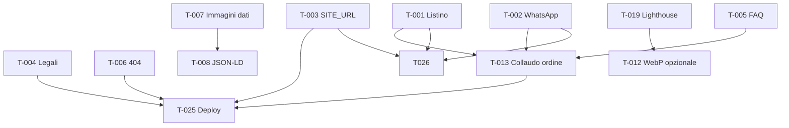

# PLAN.md — Audit e completamento del sito e-commerce

**Data audit:** 2026-10-30  
**Ambito:** repository `gramazio-tabitha` — sito statico Astro 7 per ordini diretti (carrello browser + WhatsApp/email), **senza** pagamenti online, account utente o backend ordini (scelta di prodotto documentata in `README.md`, `docs/requirements.md`, `docs/architecture.md`).

**Metodo:** analisi statica del codice, documentazione, asset in `public/`, build output in `dist/`, esecuzione `npm test` (37 test, 10 file — OK al 2026-10-30). Nessuna modifica al codice applicativo in questa fase.

---

## 1. Panoramica del progetto

### Tecnologie

| Area | Scelta |
|------|--------|
| Framework | Astro 7 (`astro.config.mjs`) — output statico, integrazioni React + sitemap |
| UI interattiva | React 19 islands (carrello, FAQ accordion, viewer 360°, stepper quantità) |
| Linguaggio | TypeScript strict, alias `@/` → `src/` |
| Validazione dati | Zod (`src/domain/catalog/catalog.schema.ts`) |
| Test | Vitest — 37 test su dominio catalogo, carrello, ordine, SEO, media |
| Qualità | ESLint + Prettier in `package.json` (lint **non** in CI GitHub Actions) |
| Deploy target | Vercel (`vercel.json`); presente anche `netlify.toml` (legacy/parallelo) |

### Architettura

- **Monolite frontend statico:** nessun database né API runtime in v1.
- **Catalogo:** dati versionati in `src/domain/catalog/products.data.ts`, validati e esposti via `src/domain/catalog/index.ts`.
- **Carrello:** `localStorage` versionato (`src/domain/cart/storage.ts`), sync con catalogo (`syncCartWithCatalog` in `src/domain/cart/logic.ts`), hook React `src/hooks/useCart.ts`.
- **Ordine:** messaggio strutturato (`src/domain/order/orderMessage.ts`) → deep link WhatsApp (`whatsapp.ts`) o `mailto:` (`mailto.ts`); nessuna persistenza ordini lato server.
- **Contenuti:** copy in `src/content/*` e `src/config/site.config.ts`; pagine legali inline in `src/pages/privacy.astro`, `cookie.astro`, `note-legali.astro`.
- **SEO:** `BaseLayout.astro` (meta, OG, canonical), JSON-LD (`src/domain/seo/structured-data.ts`), `robots.txt.ts`, `@astrojs/sitemap`.

### Obiettivo di prodotto rilevato

Vetrina professionale + catalogo + **richiesta d’ordine** con relazione umana (disclaimer in `site.config.ts`). Non un e-commerce con checkout pagato, area personale o pannello admin: vedi sezione 12 (esclusioni) e §11 (decisioni v2).

---

## 2. Mappa delle pagine e delle funzionalità esistenti

| Pagina | Route | Funzionalità principali | Componenti / dati chiave | Stato | Problemi / gap |
|--------|-------|-------------------------|---------------------------|-------|----------------|
| Homepage | `/` | Hero, about, servizi, galleria, prodotti in evidenza (3), recensioni, CTA catalogo | `index.astro`, `homePage.ts`, `ProductCard.astro` | Implementato ma non verificato (collaudo manuale ⏸) | Recensioni placeholder (`homeReviewsSection`); CTA WhatsApp home condizionata a `whatsappE164` vuoto |
| Catalogo | `/catalogo`, `?categoria=`, `?ordina=` | Filtri categoria, ordinamento, intro, avviso listino incompleto, griglia | `catalogo/index.astro`, `CatalogToolbar`, `CatalogCategoryNav`, `catalog-page.ts`, `products.data.ts` | Implementato e verificato (test dominio + refactor worklog) | Nessuna ricerca testuale; titolo hero vs intro ridondanti (UX-G6 in spec UI) |
| Scheda prodotto | `/prodotti/{slug}` (4 slug) | Hero, breadcrumb, 360°, varianti, acquisto, info, correlati, JSON-LD Product | `[slug].astro`, `ProductDetail.astro`, `ProductPurchasePanel.tsx` | Implementato ma non verificato | Slug invalido → redirect `/catalogo` (no 404); JSON-LD usa `product.image.src` non path risolto |
| Carrello / riepilogo ordine | `/carrello` | Righe, qty, totali indicativi, form opzionale, WA/email/copia, validazione telefono | `carrello.astro`, `CartPage.tsx` | Implementato e verificato (unit test + refactor) | WhatsApp ordine disabilitato se `whatsappE164` vuoto; nessun «svuota carrello» in UI |
| Chi siamo | `/chi-siamo` | Sezioni multi-blocco, galleria, CTA | `chi-siamo.astro`, `chiSiamo.ts` | Implementato ma non verificato | Timeline/storie extra non presenti (P2, dati cliente) |
| Contatti | `/contatti` | Indirizzo, tel, email, mappa embed | `contatti.astro`, `site.config.ts` | Implementato ma non verificato | Copy/recapiti da conferma definitiva |
| FAQ | `/faq` | Accordion, anchor, link incrociati, JSON-LD FAQPage | `faq.astro`, `FaqAccordion.tsx`, `faq.ts` | Implementato ma non verificato | Risposte spedizioni/pagamenti generiche finché mancano dati cliente |
| Privacy | `/privacy` | Testo informativa (bozza) | `privacy.astro` | Parzialmente implementato | Bozza — revisione professionista |
| Cookie | `/cookie` | Informativa cookie (bozza) | `cookie.astro` | Parzialmente implementato | Bozza; banner cookie assente (corretto finché no analytics) |
| Note legali | `/note-legali` | Titolare, avviso P.IVA mancante | `note-legali.astro` | Parzialmente implementato | Blocco «Dati societari da completare» |
| Robots | `/robots.txt` | Allow + sitemap | `robots.txt.ts` | Implementato | `SITE_URL` placeholder → sitemap errata in prod |
| Sitemap | `/sitemap-index.xml` | Auto da pagine | `astro.config.mjs` | Implementato | Dipende da `SITE_URL` |
| **404** | — | — | — | **Non implementato** | Astro default / hosting; nessun `404.astro` |
| Area personale / login | — | — | — | Non applicabile (v1) | By design (`docs/requirements.md`) |
| Checkout pagamento | — | — | — | Non applicabile (v1) | Sostituito da canali WA/email |
| Pannello admin | — | — | — | Non applicabile (v1) | Catalogo via codice — vedi §6 |
| Ricerca prodotti | — | — | — | Non implementato | Catalogo piccolo (4 SKU); opzionale v2 |
| Preferiti / wishlist | — | — | — | Non applicabile | — |
| Storico ordini | — | — | — | Non applicabile | Nessun backend ordini |
| Pagine stagionali | — | — | — | Non implementato | Flag `available` esiste ma non stagionalità in schema |
| Hub territorio/produzione | — | — | — | Non implementato | Opzionale se contenuti crescono |

---

## 3. Riepilogo dello stato attuale

### Operative (flusso tecnico end-to-end in locale)

- Navigazione header/footer, View Transitions (`ClientRouter` in `BaseLayout.astro`).
- Catalogo → scheda → aggiunta carrello → persistenza `localStorage` → riepilogo → messaggio ordine (email/copia sempre; WhatsApp se configurato).
- Filtri catalogo: SSR su query string + enhancement client `src/scripts/catalog-page.ts`.
- Immagini prodotto: risoluzione runtime build via `resolveProductImageSrc` / `resolvePublicImage` (file `.jpg` presenti in `public/images/products/{slug}.jpg` nonostante `placeholder-product.svg` in `products.data.ts`).
- Viewer 360°: frame in `public/images/products/{slug}/360/`.
- Test automatici dominio (37) e CI: build + test + `check:release`.

### Parziali

- **Listino commerciale:** assortimento OK (`docs/listino.md`), tutti `priceCents: null` → UI «Prezzo su richiesta», totali «da confermare».
- **WhatsApp:** `siteConfig.whatsappE164: ''` → FAB mostra `CallPopover`, carrello senza pulsante WA (`scripts/check-release.mjs` avvisa).
- **Legal / compliance copy:** struttura pagine OK, contenuti bozza + gap P.IVA (`note-legali.astro`, `information-gaps.md`).
- **Collaudo manuale / Lighthouse:** tabelle in `implementation-checklist.md` e `worklog.md` tutte «Da eseguire»; `docs/testing.md` obsoleto (es. F03-M01 cita ancora «Sito in costruzione»).
- **Campo `available`:** mostrato in UI (`display.ts`) ma **non** impedisce aggiunta al carrello (`canAddProductToCart` controlla solo `published`).

### Mancanti (rispetto a perimetro «sito completo» v1)

- Pagina 404 dedicata e coerente col brand.
- Configurazione produzione: `SITE_URL`, dominio, deploy F15.
- Dati cliente bloccanti go-live (listino numerico, legali, WhatsApp verificato, FAQ allineate).
- Collaudo accessibilità/performance documentato (F10.02, F11-M*).

### Simulate / placeholder

- Recensioni homepage (`homeReviewsSection.items` + disclaimer).
- Immagini catalogo fallback SVG in dati (sovrascritte a build da JPG reali se presenti).
- URL canonici/sitemap su `https://example.com` finché `SITE_URL` non impostata.

---

## 4. Gap analysis

Ogni voce segue la classificazione richiesta (ID, area, evidenza, stato, desiderato, soluzione, priorità, dipendenze, criterio di completamento).

### Catalogo e schede prodotto

#### CAT-001 — Listino senza prezzi numerici

| Campo | Valore |
|-------|--------|
| **Area** | Catalogo / ordine |
| **Descrizione** | Nessun prezzo in centesimi; totali carrello sempre parziali o «da confermare». |
| **Evidenza** | Tutti i prodotti in `src/domain/catalog/products.data.ts` hanno `priceCents: null`; `catalogHasIncompletePricing` → avviso in catalogo. |
| **File** | `products.data.ts`, `docs/listino.md`, `display.ts`, `CartPage.tsx` |
| **Stato** | Parzialmente implementato (UI gestisce null) |
| **Desiderato** | Formati × prezzi IVA quando comunicati dall’azienda. |
| **Soluzione** | Aggiornare `variants[]` (label, `priceCents`, opz. `unit`/`unitAmount` per €/L); rieseguire test display/cart. |
| **Priorità** | P0 (go-live commerciale) |
| **Dipendenze** | Input cliente (`docs/information-gaps.md`) |
| **Completamento** | `npm run check:release` senza avviso prezzi; card e carrello mostrano totali coerenti. |

#### CAT-002 — Dati immagine catalogo vs asset reali

| Campo | Valore |
|-------|--------|
| **Area** | Catalogo / SEO |
| **Descrizione** | `products.data.ts` punta a `placeholder-product.svg` ma esistono JPG in `public/images/products/*.jpg`. |
| **Evidenza** | `resolvePublicImage` in `productImage.ts` risolve a build; `check-release.mjs` segnala ancora placeholder nel file dati. |
| **File** | `products.data.ts`, `productImage.ts`, `resolvePublicImage.ts` |
| **Stato** | Parzialmente implementato (UI OK, dati/SEO no) |
| **Desiderato** | `image.src` in dati allineato agli asset; alt text definitivi. |
| **Soluzione** | Impostare `src: '/images/products/{slug}.jpg'` (o path reale) e alt verificati; rimuovere dipendenza implicita da fallback disco. |
| **Priorità** | P1 |
| **Dipendenze** | CAT-001 opzionale; diritti foto cliente |
| **Completamento** | Nessun `placeholder-product.svg` in `products.data.ts`; OG/JSON-LD usano URL immagine reale. |

#### CAT-003 — JSON-LD Product con immagine placeholder

| Campo | Valore |
|-------|--------|
| **Area** | SEO |
| **Descrizione** | `buildProductJsonLd` usa `product.image.src` grezzo, non `resolveProductImageSrc`. |
| **Evidenza** | `structured-data.ts` L44: `image: absoluteUrl(product.image.src)`. |
| **File** | `structured-data.ts`, `[slug].astro` |
| **Stato** | Parzialmente implementato |
| **Desiderato** | JSON-LD con URL immagine effettiva. |
| **Soluzione** | Passare path risolto da pagina prodotto (come già fatto per `ogImagePath`) a `buildProductJsonLd` o risolvere dentro builder SSR-only. |
| **Priorità** | P1 |
| **Dipendenze** | CAT-002 |
| **Completamento** | View-source scheda prodotto: `image` in JSON-LD = JPG pubblico. |

#### CAT-004 — Flag `available` non collegato al carrello

| Campo | Valore |
|-------|--------|
| **Area** | Catalogo / acquisto |
| **Descrizione** | Prodotto `available: false` resterebbe ordinabile (`canAddProductToCart` → solo `published`). |
| **Evidenza** | `logic.ts` L9-11 vs `display.ts` L19-22. |
| **File** | `logic.ts`, `AddToCartButton.tsx`, `ProductPurchasePanel.tsx` |
| **Stato** | Parzialmente implementato |
| **Desiderato** | Esaurito/non disponibile → blocco aggiunta + messaggio chiaro. |
| **Soluzione** | Estendere `canAddProductToCart` con `product.available`; test in `logic.test.ts`. |
| **Priorità** | P1 |
| **Dipendenze** | — |
| **Completamento** | Prodotto test con `available: false` non aggiungibile; label UI coerente. |

#### CAT-005 — Assenza ricerca testuale

| Campo | Valore |
|-------|--------|
| **Area** | Catalogo |
| **Descrizione** | Nessun campo ricerca per nome/descrizione. |
| **Evidenza** | Nessun componente/route search in `src/`. |
| **Stato** | Non implementato |
| **Desiderato** | Opzionale: filtro client-side o query param su 4 prodotti. |
| **Soluzione** | Solo se catalogo cresce: input + filter su `getPublishedProducts()` o pagina indice. |
| **Priorità** | P3 |
| **Dipendenze** | — |
| **Completamento** | N/A finché SKU ≤ ~10, salvo richiesta cliente. |

#### CAT-006 — Stagionalità non modellata

| Campo | Valore |
|-------|--------|
| **Area** | Catalogo |
| **Descrizione** | `information-gaps.md` chiede disponibilità stagionale; schema Zod non ha campi stagione. |
| **Evidenza** | `catalog.schema.ts` — solo `available: boolean`. |
| **Stato** | Non implementato |
| **Desiderato** | Badge «di stagione» o finestra disponibilità testuale. |
| **Soluzione** | Campo opzionale `seasonalNote` o `availableFrom`/`availableTo` + UI Notice. |
| **Priorità** | P2 |
| **Dipendenze** | Dati cliente |
| **Completamento** | Almeno un prodotto mostra nota stagionale verificabile in scheda. |

### Carrello e percorso ordine

#### ORD-001 — WhatsApp non configurato

| Campo | Valore |
|-------|--------|
| **Area** | Ordine / conversione |
| **Descrizione** | Canale ordine primario (RF-08) tecnicamente disabilitato. |
| **Evidenza** | `site.config.ts` L32-33 `whatsappE164: ''`; `buildWhatsAppUrl` ritorna `null`. |
| **File** | `site.config.ts`, `CartPage.tsx`, `WhatsAppFab.astro` |
| **Stato** | Parzialmente implementato |
| **Desiderato** | E.164 verificato → pulsante ordine + FAB WA. |
| **Soluzione** | Impostare `whatsappE164` (solo cifre); smoke test messaggio ordine reale. |
| **Priorità** | P0 |
| **Dipendenze** | Conferma cliente (`information-gaps.md`) |
| **Completamento** | `check:release` senza avviso WA; F08-M01 collaudo OK. |

#### ORD-002 — Nessuna azione «svuota carrello»

| Campo | Valore |
|-------|--------|
| **Area** | Carrello UX |
| **Descrizione** | `useCart.clear` esiste ma non esposto in UI. |
| **Evidenza** | `useCart.ts` export `clear`; `CartPage.tsx` non lo usa. |
| **Stato** | Parzialmente implementato |
| **Desiderato** | Pulsante secondario per reset ordine. |
| **Soluzione** | Aggiungere controllo con conferma in `CartPage.tsx`. |
| **Priorità** | P3 |
| **Dipendenze** | — |
| **Completamento** | Click svuota → empty state + storage pulito. |

#### ORD-003 — Persistenza form ordine solo in memoria React

| Campo | Valore |
|-------|--------|
| **Area** | Carrello |
| **Descrizione** | Nome, telefono, indirizzo, note persi al reload. |
| **Evidenza** | `useState` in `CartPage.tsx` L19-22, nessun storage. |
| **Stato** | Implementato (scelta implicita) |
| **Desiderato** | Opzionale: salvare campi in `sessionStorage`. |
| **Soluzione** | Hook leggero simmetrico a cart storage. |
| **Priorità** | P3 |
| **Dipendenze** | — |
| **Completamento** | Reload pagina carrello mantiene campi compilati. |

### Funzionalità utente

#### USR-001 — Account / profilo / ordini

| Campo | Valore |
|-------|--------|
| **Area** | Utente |
| **Descrizione** | Nessuna registrazione, indirizzi salvati, storico. |
| **Evidenza** | `docs/requirements.md` v1 out of scope. |
| **Stato** | Non applicabile (v1) |
| **Desiderato** | Coerente con modello «ordine senza account». |
| **Soluzione** | Documentare in FAQ; v2 solo se richiesto (backend). |
| **Priorità** | — |
| **Dipendenze** | Decisione prodotto v2 |
| **Completamento** | N/A v1. |

### Pannello admin e contenuti

#### ADM-001 — Gestione catalogo solo via codice

| Campo | Valore |
|-------|--------|
| **Area** | CMS |
| **Descrizione** | CRUD prodotti = edit `products.data.ts` + asset `public/`. |
| **Evidenza** | `docs/catalog-management.md`, assenza `src/pages/admin`. |
| **Stato** | Implementato (modello scelto) |
| **Desiderato** | Processo documentato per non-dev (già parziale). |
| **Soluzione** | Mantenere guida; v2 headless CMS opzionale (`requirements.md` v2). |
| **Priorità** | P2 (miglioramento processo, non blocco) |
| **Dipendenze** | — |
| **Completamento** | Cliente può aggiornare listino seguendo guida senza toccare architettura. |

### UX/UI e responsive

#### UX-001 — Collaudo tap target / Lighthouse UX

| Campo | Valore |
|-------|--------|
| **Area** | UX |
| **Descrizione** | Checklist §16 `ui-ux-redesign-spec.md`: tap 44px non verificato. |
| **Evidenza** | Voce ancora `[ ]` in spec; F10.02 ⏸ in checklist. |
| **Stato** | Da approfondire |
| **Desiderato** | Lighthouse mobile UX/accessibility ≥ obiettivi progetto. |
| **Soluzione** | Eseguire Lighthouse su home, catalogo, PDP, carrello; fix mirati CSS. |
| **Priorità** | P1 |
| **Dipendenze** | — |
| **Completamento** | Report Lighthouse archiviato; issue aperte risolte o accettate. |

#### UX-002 — Recensioni homepage simulate

| Campo | Valore |
|-------|--------|
| **Area** | Homepage / fiducia |
| **Descrizione** | Tre recensioni fittizie con disclaimer. |
| **Evidenza** | `homePage.ts` L119-144, disclaimer L123-124. |
| **Stato** | Parzialmente implementato |
| **Desiderato** | Recensioni reali o sezione rimossa. |
| **Soluzione** | Sostituire `items` o nascondere sezione fino ad approvazione. |
| **Priorità** | P1 (go-live etico/marketing) |
| **Dipendenze** | Cliente |
| **Completamento** | Nessun nome/testo inventato in produzione senza disclaimer visibile. |

#### UX-003 — Documentazione collaudo obsoleta

| Campo | Valore |
|-------|--------|
| **Area** | QA |
| **Descrizione** | `testing.md` F03-M01 non riflette sito attuale. |
| **Evidenza** | Riga «Sito in costruzione» vs homepage completa. |
| **Stato** | Parzialmente implementato |
| **Desiderato** | Procedure allineate a `worklog.md` § Test manuali. |
| **Soluzione** | Aggiornare `testing.md` e tabella checklist; allineare `implementation-checklist.md` (ESLint ora presente). |
| **Priorità** | P2 |
| **Dipendenze** | — |
| **Completamento** | Ogni scenario manuale corrisponde a pagina reale. |

### Tecnico / architetturale

#### TECH-001 — Pagina 404 assente

| Campo | Valore |
|-------|--------|
| **Area** | Routing |
| **Descrizione** | Nessun `src/pages/404.astro` o equivalente. |
| **Evidenza** | Grep `404` in `src/` vuoto; slug prodotto invalido → redirect catalogo. |
| **Stato** | Non implementato |
| **Desiderato** | 404 brandizzata con link catalogo/contatti. |
| **Soluzione** | Aggiungere `404.astro` + config host (Vercel `404.html`). |
| **Priorità** | P1 |
| **Dipendenze** | — |
| **Completamento** | URL inesistente mostra 404 custom in preview/prod. |

#### TECH-002 — Lint non in CI

| Campo | Valore |
|-------|--------|
| **Area** | Qualità |
| **Descrizione** | `npm run lint` non eseguito in `.github/workflows/ci.yml`. |
| **Evidenza** | CI: solo `test`, `build`, `check:release`. |
| **Stato** | Parzialmente implementato |
| **Desiderato** | Lint in pipeline o pre-commit documentato. |
| **Soluzione** | Aggiungere step `npm run lint` (+ opz. `format:check`). |
| **Priorità** | P2 |
| **Dipendenze** | — |
| **Completamento** | PR fallisce se ESLint error. |

#### TECH-003 — Doppia config deploy Netlify + Vercel

| Campo | Valore |
|-------|--------|
| **Area** | DevOps |
| **Descrizione** | `netlify.toml` e `vercel.json` coesistono; README punta a Vercel. |
| **Evidenza** | Root entrambi i file; F12.04 cita netlify headers. |
| **Stato** | Parzialmente implementato |
| **Desiderato** | Single source of truth hosting. |
| **Soluzione** | Deprecare netlify o documentare «solo Vercel» in `deployment.md`. |
| **Priorità** | P3 |
| **Dipendenze** | F15 deploy |
| **Completamento** | Documentazione unica; header sicurezza attivi su host scelto. |

### SEO e prestazioni

#### SEO-001 — SITE_URL / canonical placeholder

| Campo | Valore |
|-------|--------|
| **Area** | SEO / go-live |
| **Descrizione** | Build default `https://example.com`. |
| **Evidenza** | `astro.config.mjs` L8; `.env.example`; `check-release.mjs`. |
| **Stato** | Parzialmente implementato |
| **Desiderato** | Dominio produzione in build. |
| **Soluzione** | `SITE_URL` in Vercel env; verificare sitemap e canonical. |
| **Priorità** | P0 (solo per go-live pubblico) |
| **Dipendenze** | Dominio cliente |
| **Completamento** | `check:release` senza avviso URL; sitemap con host reale. |

#### SEO-002 — Font Google esterni

| Campo | Valore |
|-------|--------|
| **Area** | Performance |
| **Descrizione** | Cormorant + DM Sans da Google Fonts in ogni pagina. |
| **Evidenza** | `BaseLayout.astro` L65-69. |
| **Stato** | Implementato |
| **Desiderato** | Self-host o `font-display: swap` già parziale — misurare LCP. |
| **Soluzione** | Valutare `@fontsource` o subset; solo dopo Lighthouse. |
| **Priorità** | P2 |
| **Dipendenze** | UX-001 |
| **Completamento** | Nessun regressione visiva; metriche documentate. |

#### SEO-003 — Logo header alt vuoto

| Campo | Valore |
|-------|--------|
| **Area** | Accessibilità |
| **Descrizione** | `alt=""` su logo con link brand etichettato. |
| **Evidenza** | `Header.astro` L15-22. |
| **Stato** | Implementato (decorativo) — da verificare |
| **Desiderato** | Pattern WCAG accettabile se link ha `aria-label`. |
| **Soluzione** | Conferma in audit a11y; opz. alt testuale ridondante. |
| **Priorità** | P3 |
| **Dipendenze** | UX-001 |
| **Completamento** | axe/Lighthouse senza errore critico logo. |

### Contenuti e legali (tecnico, non conformità)

#### LEG-001 — Note legali / privacy / cookie bozze

| Campo | Valore |
|-------|--------|
| **Area** | Contenuti |
| **Descrizione** | Testi non definitivi; P.IVA mancante. |
| **Evidenza** | `note-legali.astro` L18-20; worklog P0. |
| **Stato** | Parzialmente implementato |
| **Desiderato** | Copy inserito post-acquisizione dati (senza valutazione legale in questo audit). |
| **Soluzione** | Aggiornare pagine + `site.config.ts` quando dati in `information-gaps.md` disponibili. |
| **Priorità** | P0 (go-live) |
| **Dipendenze** | Cliente / revisione esterna |
| **Completamento** | Nessun banner «da completare» in produzione. |

#### LEG-002 — FAQ non allineate a logistica reale

| Campo | Valore |
|-------|--------|
| **Area** | FAQ |
| **Descrizione** | Risposte generiche su spedizioni/pagamenti. |
| **Evidenza** | worklog FAQ P1; `faq.ts` |
| **Stato** | Parzialmente implementato |
| **Desiderato** | Testi coerenti con condizioni azienda. |
| **Soluzione** | Edit `faq.ts` + copy carrello se necessario. |
| **Priorità** | P1 |
| **Dipendenze** | Dati spedizione/pagamento cliente |
| **Completamento** | Owner conferma FAQ; link `#spedizioni` accurate. |

---

## 5. Problemi prioritari (P0 e P1)

### P0 — Bloccanti go-live / flusso ordine

| ID | Titolo |
|----|--------|
| CAT-001 | Listino senza prezzi numerici |
| ORD-001 | WhatsApp non configurato |
| SEO-001 | SITE_URL / canonical placeholder |
| LEG-001 | Pagine legali e dati titolare incompleti |

### P1 — Alta priorità

| ID | Titolo |
|----|--------|
| CAT-002 | Allineamento `products.data.ts` ↔ immagini reali |
| CAT-003 | JSON-LD Product immagine corretta |
| CAT-004 | `available` vs aggiunta carrello |
| UX-001 | Collaudo Lighthouse / accessibilità flussi |
| UX-002 | Recensioni homepage (reali o rimozione) |
| TECH-001 | Pagina 404 |
| LEG-002 | FAQ spedizioni/pagamenti allineate |

---

## 6. Piano di implementazione per fasi

Le fasi rispettano lo **scope v1** (ordine assistito). Non includono pagamenti, account o admin web salvo decisione v2 (§11).

### Fase 1 — Dati cliente e configurazione go-live (bloccanti)

- Listino (`CAT-001`), legali (`LEG-001`), WhatsApp (`ORD-001`), dominio/`SITE_URL` (`SEO-001`).
- Aggiornare FAQ e copy contatti (`LEG-002`, contatti worklog).

### Fase 2 — Correzioni strutturali e SEO tecnico

- Pagina 404 (`TECH-001`).
- JSON-LD e dati immagine catalogo (`CAT-002`, `CAT-003`).
- Logica disponibilità prodotto (`CAT-004`).

### Fase 3 — Catalogo e schede prodotto (contenuto)

- Variant/formati reali in `products.data.ts`.
- Stagionalità opzionale (`CAT-006`).
- Verifica 360° e alt text per ogni SKU.

### Fase 4 — Carrello e flusso ordine

- Smoke test WA/email/copia (`implementation-checklist` F07–F09 collaudo).
- Miglioramenti opzionali: svuota carrello (`ORD-002`), persistenza form (`ORD-003`).

### Fase 5 — Funzionalità utente

- **N/A v1** — documentare in FAQ che non serve account (`USR-001`).
- Nessun storico ordini senza backend.

### Fase 6 — Gestione contenuti (senza pannello admin)

- Rafforzare processo `catalog-management.md` (`ADM-001`).
- Valutare v2 CMS solo su richiesta.

### Fase 7 — UX/UI, responsive, fiducia

- Recensioni (`UX-002`).
- Lighthouse e tap target (`UX-001`).
- Copy homepage/chi siamo definitivo (worklog).

### Fase 8 — SEO, prestazioni, CI

- Font/immagini (`SEO-002`, worklog F11.04 WebP).
- Lint in CI (`TECH-002`).
- Chiarire hosting (`TECH-003`).

### Fase 9 — Test, collaudo, deploy

- Aggiornare `testing.md` (`UX-003`).
- Eseguire tabella collaudo `implementation-checklist.md`.
- Deploy Vercel F15 + smoke ordine reale.

---

## 7. Task operativi dettagliati

Formato: checkbox per tracking agent. **Tutti non completati** all’audit iniziale.

### Fase 1 — Dati e go-live

- [x] **T-001** (CAT-001, P0) — listino v1 indicativo in `products.data.ts` — Inserire prezzi e formati in `src/domain/catalog/products.data.ts` da `docs/listino.md` / conferma cliente. **File:** `products.data.ts`, test `display.test.ts`, `logic.test.ts`. **Dipendenze:** input azienda. **Acceptance:** almeno una variante con `priceCents` > 0 per SKU concordato; totali carrello calcolati.
- [x] **T-002** (ORD-001, P0) — `393299147756` — Impostare `whatsappE164` in `src/config/site.config.ts`. **Acceptance:** pulsante «Ordina su WhatsApp» in `CartPage.tsx` e FAB WA visibili; messaggio precompilato valido.
- [x] **T-003** (SEO-001, P0) — `DEFAULT_PRODUCTION_SITE_URL` + `.env.example` + CI `SITE_URL` — Configurare `SITE_URL` su ambiente produzione e build locale di prova. **File:** `.env.example`, `astro.config.mjs`, Vercel env. **Acceptance:** sitemap e `<link rel="canonical">` con dominio reale; `npm run check:release` pulito.
- [x] **T-004** (LEG-001, P0) — P.IVA/PEC/ATECO in config + note legali; privacy/cookie restano bozze GDPR — Completare note legali, privacy, cookie con dati societari forniti. **File:** `note-legali.astro`, `privacy.astro`, `cookie.astro`, `site.config.ts`. **Acceptance:** rimosso avviso «da completare»; P.IVA/REA presenti se forniti.
- [x] **T-005** (LEG-002, P1) — FAQ prezzi aggiornata; spedizioni/pagamenti ancora «da concordare» finché l’azienda non comunica dettagli — Allineare `src/content/faq.ts` a zone spedizione, costi, pagamenti concordati. **Acceptance:** owner legge FAQ senza incongruenze con carrello.

### Fase 2 — Struttura e SEO prodotto

- [x] **T-006** (TECH-001, P1) — Creare `src/pages/404.astro` con layout base e link utili. **Acceptance:** preview/prod mostra 404 per path inesistente.
- [x] **T-007** (CAT-002, P1) — Aggiornare `image.src` e alt in `products.data.ts` per ogni slug. **Acceptance:** nessun placeholder in dati; immagini corrette senza dipendere solo da fallback FS.
- [x] **T-008** (CAT-003, P1) — Correggere `buildProductJsonLd` per usare URL immagine risolto. **File:** `structured-data.ts`, `[slug].astro`, test `structured-data.test.ts`. **Acceptance:** JSON-LD image = URL JPG pubblico.
- [x] **T-009** (CAT-004, P1) — Collegare `available` a `canAddProductToCart`. **File:** `logic.ts`, test. **Acceptance:** prodotto non disponibile non ordinabile.

### Fase 3 — Catalogo contenuto

- [x] **T-010** (P1) — olio 500 ml / 750 ml — Aggiungere varianti multiple dove previsto (es. formati olio). **File:** `products.data.ts`, UI già supporta `ProductPurchasePanel`. **Acceptance:** selettore formato visibile quando `variants.length > 1`.
- [x] **T-011** (CAT-006, P2) — `seasonalNote` + UI fava Carpino — Estendere schema e UI per nota stagionale (campo opzionale). **File:** `catalog.schema.ts`, `ProductDetail.astro`. **Acceptance:** Zod valida; scheda mostra nota se presente.
- [x] **T-012** (P2) — hero home via WebP `homeMedia`; strip già WebP — Ottimizzare asset hero/prodotto WebP dove indicato in worklog F11.04. **File:** `public/images/`, riferimenti in content. **Acceptance:** peso pagine ridotto vs baseline Lighthouse.

### Fase 4 — Carrello e ordine

- [x] **T-013** (P1) — `npm run verify` + smoke dist; tabelle aggiornate in `docs/testing.md` — Collaudo manuale flusso ordine: catalogo → carrello → email/copia/WA. **Doc:** `worklog.md` § Test manuali, `docs/testing.md`. **Acceptance:** tabella F07-M* compilata.
- [x] **T-014** (ORD-002, P3) — Pulsante «Svuota riepilogo» in `CartPage.tsx`. **Acceptance:** storage vuoto + empty state.
- [x] **T-015** (ORD-003, P3) — Persistenza opzionale campi cliente in `sessionStorage`. **Acceptance:** reload mantiene telefono/note.

### Fase 5 — Utente

- [x] **T-016** (USR-001, N/A) — Verificare FAQ/copy chiariscono assenza account. **File:** `faq.ts`, homepage CTA. **Acceptance:** nessun link «Accedi» o promessa area personale.

### Fase 6 — Contenuti senza CMS

- [x] **T-017** (ADM-001, P2) — Revisione `docs/catalog-management.md` con esempio edit prezzo + immagine. **Acceptance:** procedura riproducibile da maintainer non-dev con supervisore.

### Fase 7 — UX/UI

- [x] **T-018** (UX-002, P1) — sezione mantenuta con disclaimer (scelta titolare) — Sostituire o rimuovere sezione recensioni in `homePage.ts`. **Acceptance:** go-live senza testimonianze inventate (salvo disclaimer esplicito approvato).
- [x] **T-019** (UX-001, P1) — `docs/lighthouse-report.md` + ottimizzazioni asset/tap target — Eseguire Lighthouse mobile su `/`, `/catalogo`, `/prodotti/olio-extravergine-biologico`, `/carrello`. **Acceptance:** score documentati; fix per issue P1 (tap target, contrasto se fall).
- [x] **T-020** (P1) — `contactsPage.ts`, contatti + `homePage.ts` servizi/ordini — Copy definitivo contatti e homepage (`contatti.astro`, `homePage.ts`). **Acceptance:** recapiti allineati a `site.config.ts`.

### Fase 8 — SEO, CI, DevOps

- [x] **T-021** (TECH-002, P2) — Aggiungere `npm run lint` a `.github/workflows/ci.yml`. **Acceptance:** CI verde con lint.
- [x] **T-022** (SEO-002, P2) — Google Fonts + `display=swap`; self-host in `docs/roadmap-v2.md` — Ottimizzazione font dopo misura. **Acceptance:** decisione documentata in worklog.
- [x] **T-023** (TECH-003, P3) — Allineare `docs/deployment.md` a Vercel-only o mantenere Netlify. **Acceptance:** un percorso deploy chiaro.

### Fase 9 — Rilascio

- [x] **T-024** (P0/P1) — `docs/testing.md` aggiornato; `implementation-checklist.md` da allineare al prossimo collaudo — Aggiornare `docs/testing.md` e stati collaudo in `implementation-checklist.md` (UX-003). **Acceptance:** nessuno scenario «sito in costruzione».
- [x] **T-025** (F15, P0 go-live) — `docs/deploy-log.md`, `release-go-live.md`, CI smoke; deploy Vercel on push — Deploy produzione Vercel, DNS, smoke test ordine reale (WA + email). **Doc:** `docs/release-go-live.md`. **Acceptance:** F15-M01 registrato.
- [x] **T-026** (P2) — `check:release` senza avvisi con `SITE_URL` default — Eseguire `npm run check:release` pre-tag release e risolvere avvisi residui. **Acceptance:** zero avvisi o lista accettata documentata.

### Opzionali / v2 (solo su decisione)

- [x] **T-027** (CAT-005, P3) — ricerca client-side catalogo (`data-catalog-search`) — Ricerca catalogo client-side.
- [x] **T-028** (v2) — tracciato in `docs/roadmap-v2.md` (fuori scope v1, decisione esplicita) — Modulo contatto serverless o CMS headless (`requirements.md` v2).

---

## 8. Dipendenze e ordine di esecuzione

**Regole:**

1. **T-001, T-002, T-004, T-003** richiedono input cliente — possono procedere in parallelo quando i dati arrivano.
2. **T-008** dipende da **T-007** (path immagine coerente).
3. **T-013** (collaudo ordine) richiede **T-001/T-002** per test realistici di totali e WA.
4. **T-025** (deploy) è ultimo: dopo legali, URL, collaudo **T-013** e preferibilmente **T-006**, **T-018**.
5. Task P2/P3 (T-014, T-015, T-027) non bloccano go-live.

---

## 9. Strategia di test

### Unitari (già presenti — mantenere verdi)

- Catalogo: `query.test.ts`, `catalogPageQuery.test.ts`, `display.test.ts`, `index.test.ts`, `productSpin.test.ts`.
- Carrello: `logic.test.ts`, `validation.test.ts`.
- Ordine: `orderMessage.test.ts`.
- SEO: `structured-data.test.ts`.
- Media: `resolvePublicImage.test.ts`.

**Dopo ogni task:** `npm test` + `npm run build`.

### Integrazione (manuale / script)

- Filtri catalogo: URL `?categoria=` + history client (`catalog-page.ts`).
- Sync carrello: prodotto `published: false` rimosso (worklog).
- View Transitions: menu mobile chiude su navigazione.

### End-to-end

- Non c’è Playwright/Cypress in repo — **collaudo manuale** obbligatorio per v1 (`docs/testing.md`, worklog § Test manuali).
- Post-deploy: smoke ordine WA (T-002), mailto su dispositivo reale (F09-M01).

### Performance / a11y

- Lighthouse mobile (T-019) su 4 URL critici.
- axe DevTools opzionale su FAQ accordion e form carrello.

### Release gate

- `npm run check:release` (T-026).
- CI GitHub: test + build (+ lint dopo T-021).

---

## 10. Criteri di completamento del progetto

Limitati al **perimetro v1** (ordine assistito, statico):

1. **Catalogo:** 4 prodotti pubblicati con immagini reali, formati/prezzi dove comunicati, categorie navigabili, schede PDP complete (info, correlati, acquisto).
2. **Ordine:** carrello persistente; invio richiesta via almeno **due** canali tra WhatsApp (configurato), email, copia testo; disclaimer visibile; validazione telefono operativa.
3. **Istituto:** home, chi siamo, contatti, FAQ coerenti con dati azienda (no placeholder ingannevoli in recensioni).
4. **Legale (tecnico):** pagine privacy/cookie/note legali senza placeholder «da completare»; link in footer.
5. **SEO tecnico:** canonical e sitemap su dominio reale; JSON-LD Organization + Product + FAQ; robots allow.
6. **Qualità:** test unitari verdi; collaudo manuale checklist compilato; Lighthouse mobile ≥ 85 (obiettivo `requirements.md`) o deviazioni documentate.
7. **Produzione:** deploy attivo, `SITE_URL` corretto, smoke test ordine eseguito.

**Non richiesto per «completo» v1:** pagamento, account, admin UI, ricerca, storico ordini, stock realtime.

---

## 11. Elementi da chiarire con il titolare

| # | Domanda | Impatto task |
|---|---------|--------------|
| Q1 | Numero WhatsApp E.164 ufficiale per ordini? | T-002, ORD-001 |
| Q2 | Listino completo (formato × prezzo IVA)? | T-001 |
| Q3 | P.IVA, REA, ragione sociale, PEC? | T-004 |
| Q4 | Zone/costi spedizione e metodi pagamento? | T-005, copy carrello |
| Q5 | Recensioni reali vs rimozione sezione? | T-018 |
| Q6 | Dominio produzione e hosting definitivo (Vercel confermato)? | T-003, T-023, T-025 |
| Q7 | Disponibilità stagionale per SKU? | T-011 |
| Q8 | Roadmap v2: CMS, modulo contatto serverless, analytics? | T-028 |
| Q9 | Sign-off design/formale F02.07? | Processo, non codice |

---

## 12. Esclusioni esplicite

Come da mandato audit:

- **Normativa** IT/EU, GDPR, cookie law compliance, termini vendita, recesso, etichettatura alimentare, IVA/fatturazione, conformità pagamenti — **non analizzate**; solo dipendenze tecniche (es. testi legali da professionista).
- **Integrazione gateway di pagamento** — fuori scope.
- **Audit normativo/legal/fiscale** — fase futura separata.
- **Verifica contrattuale** corrieri/fornitori — non trattata.

Funzionalità e-commerce «piene» escluse **per scelta di prodotto v1** (documentata): account, checkout pagato, backend ordini, magazzino, pannello admin, multilingua, blog.

---

## Riepilogo conteggio gap (stimato)

| Priorità | Conteggio ID gap §4 |
|----------|---------------------|
| P0 | 4 |
| P1 | 8 |
| P2 | 5 |
| P3 | 5 |
| N/A | 1 (USR-001) |

**Task operativi:** 28 checkbox in §7 (esclusi opzionali chiaramente marcati v2).

---

*Ultimo aggiornamento implementazione: 2026-10-31 — piano v1 chiuso; comando qualità: `npm run verify`. Evoluzione v2: `docs/roadmap-v2.md`.*
