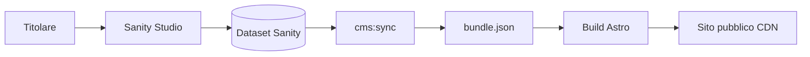

# Backoffice — guida setup e verifica

Il backoffice è **Sanity Studio** nella cartella `backoffice/`, separato dal sito statico Astro.

## Avvio in locale (sviluppatore / test)

Il backoffice **non** gira insieme ad Astro: è un “server” di sviluppo Sanity a parte. Il sito vetrina resta su un altro processo (`npm run dev` in root).

### Prerequisiti (prima volta)

1. Progetto su [sanity.io/manage](https://www.sanity.io/manage) e **Project ID** copiato.
2. File `backoffice/.env` (da `backoffice/.env.example`):

   ```env
   SANITY_STUDIO_PROJECT_ID=abc123xy
   SANITY_STUDIO_DATASET=production
   ```

3. Dipendenze Studio installate:

   ```powershell
   cd d:\progetti\gramazio-tabitha\backoffice
   npm install
   ```

4. **Obbligatorio per `cms:import`:** file `.env` nella **root** del repo (accanto a `package.json`), non solo `backoffice/.env`:

   ```env
   SANITY_PROJECT_ID=abc123xy
   SANITY_DATASET=production
   SANITY_API_TOKEN=sk...
   ```

   - `SANITY_PROJECT_ID` = stesso valore di `SANITY_STUDIO_PROJECT_ID` in `backoffice/.env` (gli script possono copiarlo da lì, ma **il token deve stare in root**).
   - Token: [sanity.io/manage](https://www.sanity.io/manage) → progetto → **API** → **Tokens** → permesso **Editor** (import) o **Viewer** (solo `cms:sync`).
   - Copia da `.env.example`; non committare `.env`.

5. (Una tantum) Caricare i contenuti del repo in Sanity:

   ```powershell
   cd d:\progetti\gramazio-tabitha
   npm run cms:import
   ```

   Poi in Studio: apri i documenti e clic **Pubblica** dove compaiono bozze.

### Avviare il server backoffice

Dalla root del repository:

```powershell
cd d:\progetti\gramazio-tabitha
npm run backoffice:dev
```

Equivalente:

```powershell
cd d:\progetti\gramazio-tabitha\backoffice
npm run dev
```

- Il terminale resta **aperto** (processo in foreground).
- Sanity stampa l’URL locale, di solito **http://localhost:3333** — aprilo nel browser.
- Al primo accesso: login con l’account Sanity invitato sul progetto (Google/GitHub/email, come configurato su sanity.io).

**Fermare il server:** `Ctrl+C` nel terminale dove gira `dev`.

### Test completo: backoffice + sito nello stesso momento

Due terminali:

| Terminale | Comando | URL browser |
|-----------|---------|-------------|
| 1 — Backoffice | `npm run backoffice:dev` (root o `backoffice/`) | http://localhost:3333 |
| 2 — Sito Astro | `npm run dev` (solo root) | http://localhost:4321 |

Dopo una modifica in Studio:

1. **Pubblica** il documento (non basta “Salva bozza”).
2. Nel terminale 2 (o un terzo), dalla root:

   ```powershell
   npm run cms:sync
   ```

3. Riavvia o ricarica il sito: Astro in dev legge `src/generated/cms/bundle.json` al riavvio del processo; se non vedi l’aggiornamento, ferma `npm run dev` e rilancialo.

Senza `SANITY_*` in root, `cms:sync` non fa nulla e il sito usa il `bundle.json` già committato.

### Problemi frequenti

| Sintomo | Cosa controllare |
|---------|------------------|
| Studio bianco / errore project | `SANITY_STUDIO_PROJECT_ID` in `backoffice/.env`, non `replace-me` |
| Login loop | Utente aggiunto in Sanity → Project → **Members** |
| Menu vuoto dopo import | Esegui `cms:import`, poi **Pubblica** i singleton in Studio |
| Sito non cambia dopo edit | `Publish` in Sanity + `npm run cms:sync` + riavvio `astro dev` |
| Porta 3333 occupata | Chiudi l’altro `sanity dev` o usa la porta indicata in console |

### Studio online (senza `npm run dev` locale)

Per un URL stabile tipo `https://nome.sanity.studio`:

```powershell
cd d:\progetti\gramazio-tabitha\backoffice
npx sanity login
npm run deploy
```

Vedi anche `backoffice/README.md`.

---

## Architettura



- **Modifica:** Studio (HTTPS, account Sanity).
- **Pubblicazione sito:** documenti **pubblicati** in Sanity → build Vercel → `cms:sync` → validazione Zod → deploy.

## Variabili d'ambiente

### Root sito (`.env` / Vercel)

| Variabile | Obbligatoria | Descrizione |
|-----------|--------------|-------------|
| `SITE_URL` | Sì | URL pubblico (già presente) |
| `SANITY_PROJECT_ID` | Per sync CMS | ID progetto Sanity |
| `SANITY_DATASET` | No | Default `production` |
| `SANITY_API_TOKEN` | Per sync CMS | Token **lettura** dataset |
| `VERCEL_DEPLOY_HOOK` | No | URL hook deploy (webhook Sanity) |
| `CMS_TRIGGER_DEPLOY` | No | `1` = chiama hook dopo sync locale |

### Backoffice (`backoffice/.env`)

| Variabile | Descrizione |
|-----------|-------------|
| `SANITY_STUDIO_PROJECT_ID` | Stesso project ID |
| `SANITY_STUDIO_DATASET` | Dataset |

## Comandi

| Comando | Dove | Azione |
|---------|------|--------|
| `npm run cms:snapshot` | Root | Rigenera `bundle.json` dai seed (senza Sanity) |
| `npm run cms:sync` | Root | Scarica da Sanity → `bundle.json` |
| `npm run cms:import` | Root | Seed iniziale → Sanity (scrittura) |
| `npm run backoffice:dev` | Root | Avvia Studio in locale |
| `npm run backoffice:deploy` | Root | Pubblica Studio su sanity.studio |

## Checklist verifica funzionale

1. [ ] Studio accessibile (`backoffice:dev`) con login Sanity.
2. [ ] Modifica prezzo prodotto → Publish → `cms:sync` → scheda prodotto aggiornata in preview.
3. [ ] FAQ modificata → visibile su `/faq`.
4. [ ] WhatsApp in Impostazioni sito → FAB e carrello aggiornati dopo build.
5. [ ] Pagina legale: avviso + corpo da CMS.
6. [ ] `npm run verify` verde dopo sync.
7. [ ] Carrello: `syncCartWithCatalog` allinea prezzo dopo reload.

## Webhook pubblicazione (consigliato)

1. Vercel → Project → Settings → Deploy Hooks → crea hook branch `main`.
2. Sanity → API → Webhooks → POST all'hook su **publish** dataset production.
3. Debounce: evitare più publish al minuto.

## Manuale operatore (sintesi)

1. Accedi allo Studio (bookmark).
2. Modifica contenuto → **Pubblica** documento.
3. Attendi rebuild sito (2–5 min) o avvia deploy da Vercel.
4. Controlla pagina live.

Per dettagli: `PLAN-BACKOFFICE.md` §18.

## Rollback

- **Contenuti:** History documento in Sanity → ripristina → Publish → rebuild.
- **Sito:** Vercel → Deployments → Promote precedente.
