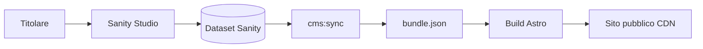

# Backoffice — guida setup e verifica

Il backoffice è **Sanity Studio** nella cartella `backoffice/`, separato dal sito statico Astro.

## Architettura

- **Modifica:** Studio (HTTPS, account Sanity).
- **Pubblicazione sito:** documenti **pubblicati** in Sanity → build Vercel → `cms:sync` → validazione Zod → deploy.

## Variabili d'ambiente

### Root sito (`.env` / Vercel)

| Variabile | Obbligatoria | Descrizione |
|-----------|--------------|-------------|
| `SITE_URL` | Sì | URL pubblico (già presente) |
| `SANITY_PROJECT_ID` | Per sync CMS | ID progetto Sanity |
| `SANITY_DATASET` | No | Default `production` |
| `SANITY_API_TOKEN` | Per sync CMS | Token **lettura** dataset |
| `VERCEL_DEPLOY_HOOK` | No | URL hook deploy (webhook Sanity) |
| `CMS_TRIGGER_DEPLOY` | No | `1` = chiama hook dopo sync locale |

### Backoffice (`backoffice/.env`)

| Variabile | Descrizione |
|-----------|-------------|
| `SANITY_STUDIO_PROJECT_ID` | Stesso project ID |
| `SANITY_STUDIO_DATASET` | Dataset |

## Comandi

| Comando | Dove | Azione |
|---------|------|--------|
| `npm run cms:snapshot` | Root | Rigenera `bundle.json` dai seed (senza Sanity) |
| `npm run cms:sync` | Root | Scarica da Sanity → `bundle.json` |
| `npm run cms:import` | Root | Seed iniziale → Sanity (scrittura) |
| `npm run backoffice:dev` | Root | Avvia Studio in locale |
| `npm run backoffice:deploy` | Root | Pubblica Studio su sanity.studio |

## Checklist verifica funzionale

1. [ ] Studio accessibile (`backoffice:dev`) con login Sanity.
2. [ ] Modifica prezzo prodotto → Publish → `cms:sync` → scheda prodotto aggiornata in preview.
3. [ ] FAQ modificata → visibile su `/faq`.
4. [ ] WhatsApp in Impostazioni sito → FAB e carrello aggiornati dopo build.
5. [ ] Pagina legale: avviso + corpo da CMS.
6. [ ] `npm run verify` verde dopo sync.
7. [ ] Carrello: `syncCartWithCatalog` allinea prezzo dopo reload.

## Webhook pubblicazione (consigliato)

1. Vercel → Project → Settings → Deploy Hooks → crea hook branch `main`.
2. Sanity → API → Webhooks → POST all'hook su **publish** dataset production.
3. Debounce: evitare più publish al minuto.

## Manuale operatore (sintesi)

1. Accedi allo Studio (bookmark).
2. Modifica contenuto → **Pubblica** documento.
3. Attendi rebuild sito (2–5 min) o avvia deploy da Vercel.
4. Controlla pagina live.

Per dettagli: `PLAN-BACKOFFICE.md` §18.

## Rollback

- **Contenuti:** History documento in Sanity → ripristina → Publish → rebuild.
- **Sito:** Vercel → Deployments → Promote precedente.
