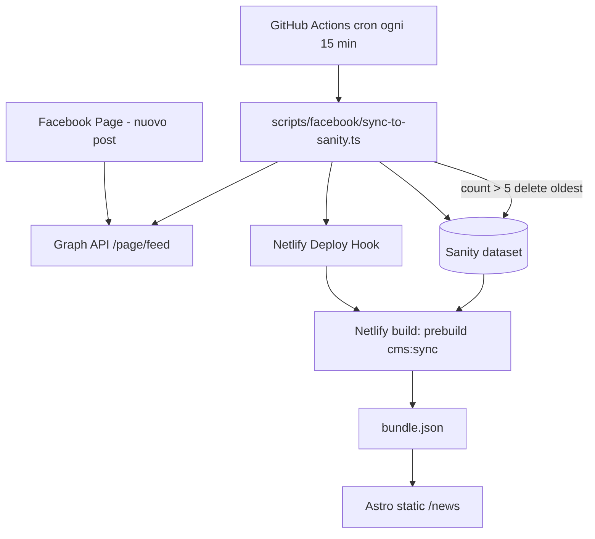

# PLAN-NEWS-FACEBOOK — Pagina News sincronizzata con Facebook

**Repository:** `gramazio-tabitha`  
**Cliente:** Azienda Agricola Gramazio Tabitha  
**Documento:** piano tecnico per agente di implementazione (solo pianificazione)  
**Data:** 2026-11-01  
**Stack verificato:** Astro 7 (sito statico), Sanity Studio (`backoffice/`), sync build `cms:sync` → `src/generated/cms/bundle.json`, deploy Netlify (`netlify.toml`, `prebuild` = sync)

---

## 1. Executive summary

### Obiettivo di prodotto

1. Pubblicare una pagina pubblica **`/news`** sul sito vetrina.
2. La pagina deve **richiamare la pagina Facebook dell’azienda** (link prominente + contesto).
3. **Ogni nuovo post sulla Page Facebook** deve generare **automaticamente** una voce “news” visibile sul sito (senza intervento dello sviluppatore).
4. Sul sito devono restare **al massimo 5 news**: alla pubblicazione della sesta (e successive), la **meno recente** deve **sparire dal sito** (politica FIFO per data di pubblicazione).

### Vincoli architetturali (ereditati dal progetto)

- Sito **100% statico** a build time: nessun adapter server, nessuna API runtime sul dominio pubblico.
- Contenuti editoriali gestiti via **Sanity** + **`npm run cms:sync`** in `prebuild` (vedi `docs/backoffice-setup.md`).
- URL esistenti **non devono rompersi**; aggiungere `/news` e aggiornare navigazione/footer via CMS dove possibile.
- Carrello, ordini, legali: **fuori perimetro**.

### Soluzione raccomandata (sintesi)

| Layer | Scelta |
|-------|--------|
| **Contenuto sul sito** | Documenti Sanity `newsItem` (max 5 attivi), intro pagina singleton `newsPage` |
| **Rendering** | `src/pages/news.astro` legge dal bundle CMS (come `/faq`) |
| **Sincronizzazione Facebook → CMS** | Script Node schedulato (GitHub Actions cron **consigliato**) che interroga **Facebook Graph API**, crea news mancanti in Sanity, **elimina** la più vecchia se `count > 5`, poi invoca **Netlify Deploy Hook** |
| **Pubblicazione sito** | Deploy Netlify → `prebuild` → `cms:sync` → build Astro |

**Perché non solo “embed Facebook”:** un widget feed non garantisce controllo SEO, accessibilità, coerenza grafica né la regola “massimo 5 voci” sul dominio proprio. L’embed può restare **opzionale** come link “Vedi su Facebook”, non come unica fonte.

**Perché non solo manuale in Studio:** il requisito esplicito è l’automazione post-per-post; Studio resta utile per correzioni eccezionali e testo intro pagina.

---

## 2. Requisiti funzionali

### RF-01 — Pagina `/news`

- Route: **`/news`** (`src/pages/news.astro`).
- Hero: titolo, lead, immagine — allineati al pattern `PageHero` + voce in `pageHeroes` (CMS) o campi dedicati su `newsPage`.
- Sezione intro editabile (breve testo + URL pagina Facebook).
- Elenco delle news (0–5), ordinate **dalla più recente alla più vecchia**.
- Ogni card/voce mostra almeno: **data**, **titolo o anteprima**, **link al post originale su Facebook** (`permalink_url`).
- Se presente immagine nel post FB, mostrarla (ottimizzata in sync come per i prodotti, se fattibile).
- Stato vuoto: messaggio amichevole + CTA Facebook (nessun post ancora sincronizzato).
- Link in **menu header** e/o **footer** (preferibile: campi `nav` / `footerInfoLinks` in `siteSettings` Sanity, già supportati).

### RF-02 — Sincronizzazione post Facebook

- Identificatore stabile: **`facebookPostId`** (ID post Graph API) — univoco in Sanity.
- All’esecuzione del job:
  1. Leggere gli ultimi post della Page (soglia configurabile, es. ultimi 10 per non perdere post in ritardo).
  2. Per ogni post FB **non ancora presente** in Sanity → creare documento `newsItem` **pubblicato**.
  3. Mappatura contenuto minima:
     - `message` → corpo/anteprima (plain text o HTML limitato coerente con FAQ).
     - `created_time` → `publishedAt`.
     - `permalink_url` → `facebookUrl`.
     - Allegato foto → campo immagine Sanity (upload asset) **se** il post ha `full_picture` / attachment photo.
  4. Ignorare tipi non desiderati (es. solo status/photo/link; definire in implementazione — default: tutti i post pagina tranne commenti puri).
- **Idempotenza:** ristampare lo stesso job non deve duplicare news.

### RF-03 — Limite 5 news (FIFO)

- Dopo aver creato eventuali news mancanti, contare i documenti `newsItem` **pubblicati** (o tutti non archiviati — scegliere una regola e documentarla).
- Ordinare per `publishedAt` **ascendente** (più vecchia prima).
- Mentre `count > 5`: **eliminare** (o archiviare con flag escluso dal sync) la più vecchia.
- Il sito statico deve **mai** mostrare più di 5 voci: validazione anche in `cms:sync` (fail build o trim difensivo + log).

### RF-04 — Riferimento alla pagina Facebook

- URL pagina FB configurabile (Sanity `newsPage.facebookPageUrl` o `siteSettings`).
- Visibile in hero, footer sezione news, e/o pulsante “Seguici su Facebook”.
- `rel="noopener noreferrer"` su link esterni; icona opzionale.

### RF-05 — Pubblicazione end-to-end

- Nuovo post su Facebook → entro **T minuti** (target SLA interno: **≤ 30 min** con cron ogni 15 min) → news visibile su `/news` dopo deploy.
- Deploy automatico dopo sync CMS (Deploy Hook Netlify già documentato in `docs/backoffice-setup.md` § Webhook).

---

## 3. Requisiti non funzionali

| ID | Requisito |
|----|-----------|
| RNF-01 | Nessun segreto (token FB, Sanity write) nel repository o nel bundle client |
| RNF-02 | Script sync FB eseguibile in CI (GitHub Actions) con secrets |
| RNF-03 | `npm run verify` verde dopo implementazione |
| RNF-04 | Accessibilità: lista semantica (`<article>`, date in `<time datetime>`), alt immagini |
| RNF-05 | SEO: `title`/`description` dedicati; opzionale JSON-LD `ItemList` (vedi `src/domain/seo/structured-data.ts`) |
| RNF-06 | Manuale operatore aggiornato (`docs/backoffice-manuale-operatore.md`) — spiegare che le news **normalmente** arrivano da Facebook |
| RNF-07 | Resilienza: se Graph API down, job fallisce ma **non** corrompe CMS; log chiaro |

---

## 4. Stato attuale (as-is)

| Elemento | Stato |
|----------|--------|
| Pagina `/news` | **Assente** |
| Schema Sanity news | **Assente** |
| Link social in `siteSettings` | **Assente** (solo contatti WhatsApp/email) |
| Integrazione Facebook | **Assente** |
| Pattern da riusare | `/faq` + `faqPage` CMS, `sync-from-sanity.ts`, `CmsBundle`, `PageHero`, navigazione da bundle |

File di riferimento per l’agente:

- Pagina tipo: `src/pages/faq.astro`
- CMS load: `src/content/faq.ts`, `src/cms/loadBundle.ts`, `src/cms/types.ts`
- Sync: `scripts/cms/sync-from-sanity.ts`
- Studio: `backoffice/schemaTypes/*`, `backoffice/structure/index.ts`
- Smoke build: `scripts/smoke-dist.mjs`
- Mappa URL: `docs/page-paths.md`

---

## 5. Architettura target (to-be)



### 5.1 Flusso dati news sul sito

1. `cms:sync` esteso con query GROQ `newsItems` + `newsPage`.
2. Mapper produce snapshot tipizzato in `CmsBundle` (nuova sezione `news` o sotto `editorial`).
3. `src/content/news.ts` (o simile) espone `getNewsForPage()` — **slice max 5**, sort desc (difesa in profondità).
4. `news.astro` importa e renderizza.

### 5.2 Cosa vede l’operatore in Sanity

- **News** (lista documenti): solo lettura/correzione eccezionale; campo `facebookPostId` read-only.
- **Pagina News** (singleton): intro, URL Facebook, testi CTA.
- **Banner pagine**: chiave `news` in `pageHeroes` (coerente con FAQ, contatti, …).

Policy consigliata in Studio: messaggio “Le news sono sincronizzate da Facebook; non creare manualmente salvo emergenza”.

---

## 6. Modello dati Sanity

### 6.1 Document type `newsItem`

| Campo | Tipo | Note |
|-------|------|------|
| `facebookPostId` | `string` | Required, unique (validation custom) |
| `title` | `string` | Opzionale; fallback: prime N parole del messaggio |
| `excerpt` | `text` | Anteprima lista (max ~200 caratteri) |
| `bodyHtml` | `text` | Corpo completo (HTML limitato come FAQ) o plain text |
| `publishedAt` | `datetime` | Da FB `created_time` |
| `facebookUrl` | `url` | `permalink_url` |
| `image` | `image` + `alt` | Opzionale |
| `syncedAt` | `datetime` | Ultimo aggiornamento da script |

Non serve slug pubblico `/news/[slug]` per MVP (riduce scope SEO/canonical); se aggiunto in v2, usare slug stabile derivato da `facebookPostId`.

### 6.2 Singleton `newsPage`

| Campo | Tipo |
|-------|------|
| `intro` | `text` |
| `facebookPageUrl` | `url` |
| `facebookCtaLabel` | `string` (default: “Seguici su Facebook”) |
| `emptyStateMessage` | `text` |

### 6.3 Estensioni opzionali `siteSettings`

- `facebookPageUrl` (duplicato accettabile se si preferisce un solo punto per tutto il sito).

### 6.4 Snapshot TypeScript (`src/cms/types.ts`)

```ts
export type NewsItemSnapshot = {
  id: string;
  facebookPostId: string;
  title: string;
  excerpt: string;
  bodyHtml: string;
  publishedAt: string; // ISO
  facebookUrl: string;
  image?: { src: string; alt: string };
};

export type NewsPageSnapshot = {
  intro: string;
  facebookPageUrl: string;
  facebookCtaLabel: string;
  emptyStateMessage: string;
};
```

Aggiornare `CmsBundle` con `news: { page: NewsPageSnapshot; items: NewsItemSnapshot[] }`.

---

## 7. Integrazione Facebook Graph API

### 7.1 Prerequisiti Meta (setup manuale — checklist per cliente/dev)

1. Pagina Facebook aziendale esistente; ruolo **Admin** sull’account che configura l’app.
2. Creare app su [developers.facebook.com](https://developers.facebook.com) (tipo “Business”).
3. Aggiungere prodotto **Facebook Login** o **Graph API** e collegare la Page.
4. Ottenere **Page ID** e **Page Access Token** long-lived:
   - Flusso tipico: User token → `/me/accounts` → token pagina → scambio long-lived.
5. Permessi minimi indicativi: `pages_read_engagement`, `pages_show_list` (verificare con documentazione Meta corrente per lettura feed Page).
6. **App Review:** in dev mode spesso funziona solo per admin/tester; per produzione serve review Meta se richiesto dai permessi.

Documentare URL pagina FB reale in `.env.example` (placeholder), mai il token.

### 7.2 Endpoint e query

- `GET /{page-id}/posts` o `/feed` con campi:
  - `id`, `message`, `created_time`, `permalink_url`, `attachments{media,type,url}`, `full_picture` (se disponibile).
- Paginazione: seguire `paging.next` fino a coprire almeno gli ultimi N post o finestra temporale.

### 7.3 Script `scripts/facebook/sync-to-sanity.ts`

Responsabilità:

1. Caricare env (`loadDotenv` pattern da `scripts/cms/loadDotenv.ts`).
2. Client Sanity con token **Editor** (scrittura).
3. Fetch post FB.
4. Upsert/create `newsItem` per ID mancanti.
5. Applicare regola FIFO delete (Sanity `client.delete` su documenti più vecchi).
6. Opzionale: `POST` a `NETLIFY_DEPLOY_HOOK` se `CMS_TRIGGER_DEPLOY=1` (riuso variabile esistente).

CLI npm suggerito: `"facebook:sync": "tsx scripts/facebook/sync-to-sanity.ts"`.

**Test unitari:** estrarre funzione pura `selectPostsToImport`, `pruneOldestBeyondLimit(items, limit=5)` in `src/domain/news/` + Vitest.

### 7.4 Scheduling (raccomandato)

**GitHub Actions** `.github/workflows/facebook-news-sync.yml`:

- Trigger: `schedule: cron('*/15 * * * *')` + `workflow_dispatch` manuale.
- Secrets repo:
  - `FACEBOOK_PAGE_ID`
  - `FACEBOOK_PAGE_ACCESS_TOKEN`
  - `SANITY_PROJECT_ID`, `SANITY_DATASET`, `SANITY_API_TOKEN` (write)
  - `NETLIFY_DEPLOY_HOOK`
- Steps: `npm ci` → `npm run facebook:sync`.

Alternative (documentare ma non implementare in MVP se non richiesto):

- Netlify Scheduled Function (a pagamento/limiti diversi).
- Webhook Meta `feed` (real-time ma setup più fragile).

---

## 8. Implementazione frontend (Astro)

### 8.1 Pagina `src/pages/news.astro`

- `BaseLayout` con title/description da CMS o default italiano.
- `PageHero` con chiave `news` da `staticPageHeroes`.
- Componente presentazionale `NewsList.astro` (o React solo se necessario — preferire Astro statico).
- Card con link esterno a Facebook per “Leggi su Facebook” / permalink.
- **Non** incorporare iframe Facebook obbligatorio (cookie/privacy); link outbound sufficiente per MVP.

### 8.2 Stili

- Riutilizzare token esistenti (`global.css`, pattern card FAQ/catalogo).
- File dedicato opzionale: `src/styles/news.css` importato dalla pagina.

### 8.3 Navigazione

- Aggiornare seed/snapshot e documento Sanity `siteSettings`:
  - Voce menu es. `{ href: '/news', label: 'News' }` (posizione: gruppo “Azienda” se presente).
  - Footer: link “News” in `footerInfoLinks`.
- Dopo deploy CMS, operatore può spostare voce senza deploy codice.

---

## 9. Modifiche pipeline CMS esistente

Checklist file da toccare (agente):

| Area | File / azione |
|------|----------------|
| Schema Sanity | `backoffice/schemaTypes/newsItem.ts`, `newsPage.ts`, export in `index.ts` |
| Desk | `backoffice/structure/index.ts` — voce “News” + singleton pagina |
| Sync | `scripts/cms/sync-from-sanity.ts` — QUERY + mapping immagini news |
| Types | `src/cms/types.ts`, `src/cms/legacyBundle.ts` se usato |
| Snapshot repo | `scripts/cms/snapshot-from-repo.ts`, seed in `src/content/seeds/` |
| Import iniziale | `scripts/cms/import-to-sanity.ts` |
| Content adapter | `src/content/news.ts` |
| Hero | seed `pageHeroes` con chiave `news` |
| Validazione | Zod opzionale su snapshot news in sync |
| Smoke | `scripts/smoke-dist.mjs` — `news/index.html` |
| Docs | `docs/page-paths.md`, `docs/backoffice-manuale-operatore.md` |
| Env example | `.env.example`, `backoffice/.env.example` — solo nomi variabili FB |

### 9.1 Regola max 5 a build time

In `sync-from-sanity.ts`, dopo fetch:

```ts
items.sort(byPublishedAtDesc).slice(0, 5);
```

Se Sanity contiene più di 5 documenti per bug, log warning; opzionalmente fallire build in CI (`NEWS_STRICT_MAX=1`).

---

## 10. Sicurezza e privacy

- Token Facebook e Sanity write **solo** in GitHub Secrets / Netlify env (scope server-side script).
- Non esporre token in client bundle (verificare con grep post-implementazione).
- Contenuti copiati dalla Page proprietaria — OK operativo; evitare dati personali di terzi nei post (policy editoriale cliente).
- Aggiornare **Privacy/Cookie** solo se si aggiungono embed Meta (MVP link-only: impatto minimo; annotare in nota per legale).

---

## 11. Piano di implementazione per fasi

### Fase 0 — Prerequisiti Meta e env (0,5–1 g)

- [ ] Page ID e URL pubblico Facebook documentati.
- [ ] App Meta + token long-lived validato con curl/Graph API Explorer.
- [ ] Token Sanity Editor per script.
- [ ] Deploy Hook Netlify attivo.

**Criterio di uscita:** chiamata manuale Graph API restituisce almeno 1 post.

### Fase 1 — CMS e bundle (1–1,5 g)

- [ ] Schema `newsItem`, `newsPage`, desk Studio.
- [ ] Estensione sync + types + snapshot seed vuoto o demo.
- [ ] `npm run cms:import` / publish singleton in Studio (istruzioni in PR).
- [ ] Test: `cms:sync` produce `news` nel bundle.

**Criterio di uscita:** bundle contiene `news.page` e array `items`.

### Fase 2 — Pagina `/news` (0,5–1 g)

- [ ] `news.astro` + componenti + hero.
- [ ] Nav/footer via CMS.
- [ ] JSON-LD opzionale.
- [ ] Aggiornare `docs/page-paths.md`.

**Criterio di uscita:** `npm run dev` mostra pagina con dati seed; link FB funzionante.

### Fase 3 — Script Facebook → Sanity (1,5–2 g)

- [ ] `scripts/facebook/sync-to-sanity.ts` + test Vitest FIFO/idempotenza.
- [ ] `npm run facebook:sync` locale (dry-run flag consigliato `--dry-run`).
- [ ] GitHub Action schedulata + workflow_dispatch.

**Criterio di uscita:** simulando 6 post (mock o pagina test), sul CMS restano 5; il più vecchio eliminato.

### Fase 4 — Integrazione deploy e QA (0,5–1 g)

- [ ] Hook deploy dopo sync.
- [ ] Estendere `smoke-dist.mjs`.
- [ ] `npm run verify` completo.
- [ ] Manuale operatore aggiornato.

**Criterio di uscita:** post test su FB (o mock) → entro 2 cicli cron appare su `/news` in produzione.

---

## 12. Test e collaudo

### Automatici

| Test | Descrizione |
|------|-------------|
| `pruneOldestBeyondLimit` | 6 item → restano 5 corretti per data |
| `mapFacebookPostToNewsItem` | message vuoto, solo foto, con link |
| Idempotenza | stesso feed due volte → stesso count Sanity |
| Build | `news/index.html` in dist |
| Lint/test CI | workflow esistente `.github/workflows/ci.yml` |

### Manuali (checklist)

1. [ ] `/news` in menu e footer.
2. [ ] Hero e intro modificabili da Studio → sync → visibili.
3. [ ] Pubblicare post su Page FB → attendere job → news in cima lista.
4. [ ] Dopo 6° post, la più vecchia **non** compare più su `/news` né in Studio (se delete hard).
5. [ ] Link “apri su Facebook” corretto.
6. [ ] Mobile: card leggibili.
7. [ ] Lighthouse/accessibilità base (contrasto, alt immagini).

---

## 13. Rischi e mitigazioni

| Rischio | Impatto | Mitigazione |
|---------|---------|-------------|
| Meta revoca permessi / App Review ritardata | Sync ferma | Monitor job GH; alert email on failure; istruzioni rinnovo token |
| Token scaduto | Nessuna news nuova | Documentare rinnovo semestrale; workflow fallisce visibile |
| Post senza testo (solo foto) | Card vuota | Fallback title “Aggiornamento” + alt da nome azienda |
| Rate limit Graph API | Ritardo sync | Backoff; cron non più frequente di 15 min |
| Operatore crea news manuali duplicate | Duplicati | Validation `facebookPostId` unique; policy Studio |
| Più di 5 doc in Sanity per bug | Sito mostra >5 | Slice a build + allarme log |
| Deploy Hook spam | Troppe build | Debounce: deploy solo se creato ≥1 documento nuovo o delete in run |

---

## 14. Fuori scope (MVP)

- Pagina dettaglio `/news/[slug]` indicizzata singolarmente.
- Commenti Facebook embedded.
- Traduzione multilingua.
- Notifiche push / email al titolare.
- Moderazione contenuti (filtri parole) oltre a esclusione tipi post.
- Sincronizzazione Instagram/LinkedIn.

---

## 15. Deliverable attesi dall’agente implementatore

1. Codice completo Fasi 1–4 nel repository.
2. Workflow GitHub Actions con secrets documentati in `.env.example`.
3. Aggiornamento documentazione (`page-paths`, manuale operatore, breve sezione in `docs/backoffice-setup.md` se necessario).
4. PR con descrizione: setup Meta, come lanciare `facebook:sync --dry-run`, come verificare FIFO.
5. Opzionale: 1–2 news demo nel seed snapshot per preview senza FB.

---

## 16. Variabili d’ambiente (riepilogo)

| Variabile | Dove | Uso |
|-----------|------|-----|
| `FACEBOOK_PAGE_ID` | GitHub Secrets | Graph API |
| `FACEBOOK_PAGE_ACCESS_TOKEN` | GitHub Secrets | Graph API |
| `SANITY_PROJECT_ID` | Già presente | Script sync |
| `SANITY_DATASET` | Già presente | Script sync |
| `SANITY_API_TOKEN` | GitHub Secrets (Editor) | Scrittura news |
| `NETLIFY_DEPLOY_HOOK` | GitHub Secrets | Deploy post-sync |
| `CMS_TRIGGER_DEPLOY` | Opzionale locale | `1` = chiama hook da script |
| `NEWS_MAX_ITEMS` | Opzionale | Default `5` |
| `FACEBOOK_PAGE_URL` | Opzionale override | Se non solo da CMS |

---

## 17. Definition of Done

- [ ] Requisiti RF-01 … RF-05 soddisfatti in produzione o preview Netlify.
- [ ] Massimo **5** news visibili su `/news` con prova del 6° post che rimuove la più vecchia.
- [ ] Automazione schedulata attiva e documentata.
- [ ] Nessun segreto nel repo; `npm run verify` verde.
- [ ] Operatore informato (manuale): flusso “post su Facebook → sito aggiornato” senza passi tecnici.

---

*Fine piano — pronto per handoff ad agente di implementazione.*
