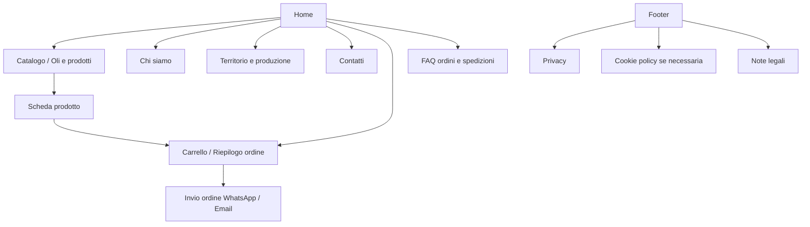
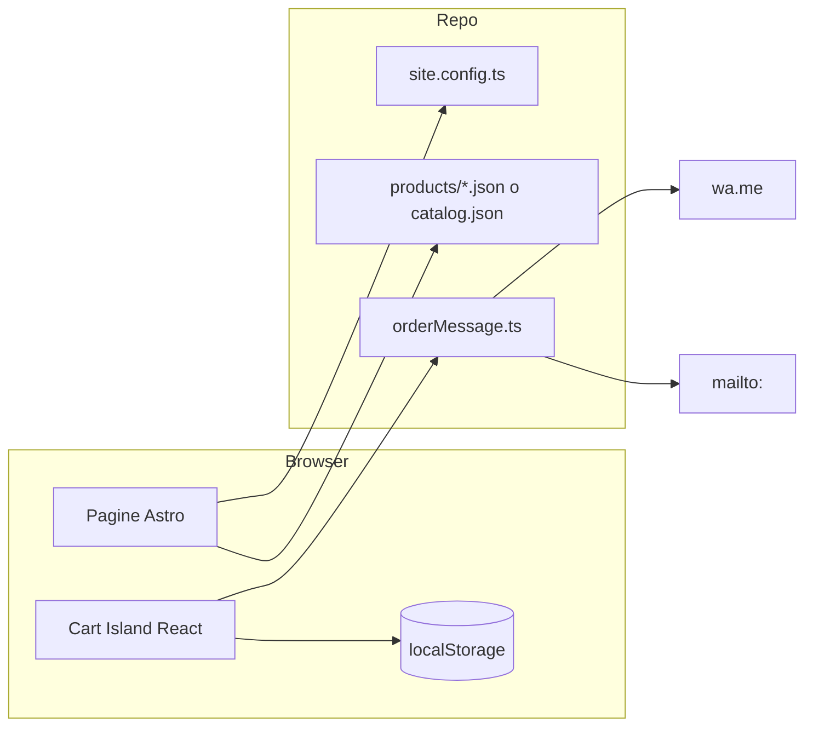

# Documento di analisi — Azienda Agricola Gramazio Tabitha

Analisi strutturale, tecnica, funzionale e strategica per la progettazione del sito web (catalogo commerciale interattivo con richiesta d'ordine, senza account).

**Fase:** analisi e progettazione (nessun codice applicativo in questa fase).  
**Repository al momento dell'analisi:** branch `main`, commit iniziale, README placeholder.  
**Data analisi:** ottobre 2026.

---

## 1. Executive summary

**Obiettivo:** sito vetrina con **catalogo commerciale interattivo** e **richiesta d'ordine** via WhatsApp ed email, **senza account** né pagamento online in v1.

**Contesto aziendale (verificato):** produttore a **Carpino (FG)**; olio EVO **biologico** da cultivar autoctone; **Fava di Carpino** (riferimento Slow Food); altri prodotti citati (La Favetta, patè di fave). Contatti su [Cibovagare — Gramazio Tabitha](https://www.cibovagare.it/jesologourmetfestival/espositori/az-agr-gramazio-tabitha.html): Via Matteotti 54, `francescocannarozzi@virgilio.it`, **+39 333 412 5391**. **Non risulta un sito proprietario** né listino prezzi pubblico.

**Raccomandazione tecnica:** **Alternativa 1** — sito **statico** (consigliato **Astro** + TypeScript), catalogo in **file dati centralizzati** (`products.json` + `site.config.ts`), carrello in **localStorage**, ordini via **WhatsApp Click to Chat** + **`mailto:`**, hosting statico (Netlify/Cloudflare Pages/Vercel). Costi ricorrenti bassi, performance e SEO elevate, manutenzione catalogo via Git o edit file guidato.

**Canale ordini in evidenza:** **WhatsApp** (mobile-first, coerente con il settore e con competitor come Agricola Conforti / La Molazza).

**Bloccanti per go-live:** prezzi, formati, foto, P.IVA/dati legali, policy spedizioni/pagamenti, conferma numero WhatsApp, testi certificazioni (bio, Slow Food).

---

## 2. Analisi dell'azienda

| Elemento | Stato | Fonte |
|----------|--------|--------|
| Nome | Azienda Agricola Gramazio Tabitha | Cibovagare |
| Sede | Via Matteotti, 54 — 71010 Carpino (FG) | Cibovagare |
| Settore | Oli, aceti e condimenti (stand 43) | Cibovagare |
| Posizionamento | Artigianale sostenibile; rispetto cicli natura; olio bio da cultivar autoctone | Cibovagare |
| Prodotti citati | Olio EVO biologico; Fava di Carpino; La Favetta; Patè di Fave | Cibovagare |
| Email | francescocannarozzi@virgilio.it | Cibovagare |
| Telefono | +39 333 412 5391 | Cibovagare |
| Prezzi | **Non disponibili** | — |
| Sito web | **Non verificato** (solo scheda evento) | — |
| WhatsApp dedicato | **Non dichiarato** (il cellulare potrebbe coincidere — da confermare) | — |
| Certificazioni bio | Citata testualmente; **documenti/schede non verificate** | Cibovagare |
| P.IVA, REA, titolare | **Da acquisire** | — |

**Dati da acquisire dall'azienda:** listino completo (formati, €, €/L), disponibilità stagionale, metodi pagamento accettati, costi/spedizioni, orari contatto, foto prodotto/azienda/territorio, testi istituzionali, eventuali numeri lotto/DOP/IGP (solo se reali), informativa privacy e dati societari.

---

## 3. Analisi dei competitor

**Metodo:** fetch contenuti homepage/shop (ottobre 2026). **Non verificato:** checkout completo, UX mobile reale, Lighthouse, backend, cookie banner su ogni sito.

### Tabella comparativa (sintesi)

| Competitor | URL | Punti di forza | Debolezze | Grafica / UX | Commercio | Idee per Gramazio | Da evitare |
|------------|-----|----------------|-----------|--------------|-----------|-------------------|------------|
| **Gramazio Tabitha** (riferimento) | [Cibovagare](https://www.cibovagare.it/jesologourmetfestival/espositori/az-agr-gramazio-tabitha.html) | Storia territorio Gargano, bio + Slow Food | Nessun sito, no prezzi, no ordine digitale | Scheda evento, non brand | Nessuno | Contenuti autentici da riusare (con permesso) | Dipendere solo da portali terzi |
| **Oliottaviani** | [oliottaviani.com](https://www.oliottaviani.com/) | Trasparenza (€/L, lotto, grezzo/filtrato), Trustpilot, storytelling 1905 | E-commerce pieno (Shopify-like), complessità vs modello "richiesta ordine" | Tipografia editorial, bilingue, premium | Carrello + pagamento online, soglia spedizione €120 | Prezzo unitario €/L, codice lotto (se applicabile), recensioni (se reali) | Gift card, e-commerce pesante se non serve pagamento |
| **Frantoio Il Vascello** | [frantoioilvascello.it](https://www.frantoioilvascello.it/) | Narrativa tradizione, processo produttivo, fiducia | Sito più vetrina; ordine online non evidente in homepage | Classico, foto frantoio | Tel/email; degustazione (sospesa COVID in testo) | Sezione "come riconoscere EVO", fasi produzione | Testi datati (COVID) non aggiornati |
| **Frantoio Cacioli** | [frantoiocacioli.com](https://www.frantoiocacioli.com/) | Territorio Arezzo–Cortona chiaro | Homepage essenziale; **shop/prodotti non accessibili** (404 su `/shop/`, `/prodotti/`) | Sobrio | Non verificato online | Breve "chi siamo" territoriale | Navigazione verso pagine rotte |
| **Frantoio Settimi** | [frantoiosettimi.it](https://www.frantoiosettimi.it/) | Vendita online dichiarata, prodotti in evidenza | Layout e-commerce generico | Template shop | WooCommerce-style, telefono/email | Card prodotto con annata (2025/26) | Sovraccarico plugin se sito statico basta |
| **Bigucci** | [bigucci.it](https://www.bigucci.it/) | Shop chiaro, prezzi visibili, categorie (olio, gastronomia, regalo) | Slider ripetitivo homepage | Commerciale familiare | E-commerce, spedizione gratis >€100 | Griglia prodotti con "Acquista", formati multipli | Troppi banner promozionali |
| **Frantoio Selvanera** | [frantoioselvanera.com](https://www.frantoioselvanera.com/) | Bio, IGP, tracciabilità, Capalbio | Contenuto shop **non approfondito** nel fetch | Pulito, moderno | Tel/email; e-commerce probabile | Claim tracciabilità **solo se documentato** | Certificazioni non verificate per Gramazio |
| **Agricola Conforti** | [agricolaconforti.it](https://www.agricolaconforti.it/) | SEO forte, €/L, WhatsApp, trust (Google reviews), FAQ spedizione/pagamento | Modello e-commerce completo (carta, PayPal, contrassegno) | Conversion-oriented | Shop + WhatsApp + telefono | WhatsApp visibile, trasparenza prezzo/L, pagina "ordini e spedizioni" | Pagamenti online se l'azienda non li vuole in v1 |
| **Frantoio La Molazza** *(extra)* | [frantoiolamolazza.it](https://frantoiolamolazza.it/negozio/) | WhatsApp in footer, FAQ ordini | E-commerce standard | — | Carrello + WhatsApp per custom | Footer con WhatsApp + email ordini | — |
| **Olio Ciavatta** *(extra, Puglia/Gargano area)* | [oliociavatta.it](https://oliociavatta.it/pages/prenotazioneolionuovo) | Prenotazione olio nuovo, WhatsApp fallback | Checkout con pagamento | — | Prenotazione + WhatsApp 3516429101 | Messaggio "richiesta da confermare" | Prenotazione con acconto se non richiesto |

---

## 4. Benchmark grafico e funzionale

| Pattern | Frequenza competitor | Rilevanza Gramazio |
|---------|---------------------|-------------------|
| Hero + CTA "scopri oli" | Alta | Alta |
| Prezzo + **€/litro** | Media-alta (Ottaviani, Conforti) | Alta per olio |
| Storia/frantoio/territorio | Alta | Alta (Carpino, Gargano) |
| WhatsApp floating / footer | Media | **Molto alta** |
| E-commerce + pagamento | Alta | **Escluso v1** (per scelta progetto) |
| Recensioni esterne | Media | Opzionale (solo se verificabili) |
| Blog/ricette | Bassa-media | Opzionale fase 2 |

**Gap competitivo:** Gramazio oggi è **invisibile fuori da portali evento**; un sito leggero con catalogo + ordine immediato colma il divario rispetto a Conforti/Bigucci senza imporre WooCommerce.

---

## 5. Direzione artistica consigliata

### Direzione A — «Gargano autentico»

- **Palette:** verde oliva `#4A5D3F`, crema `#F7F3EA`, terracotta `#9C6B4E`, testo `#2C2A26`.
- **Tipografia:** serif display (titoli, es. *Fraunces* / *Cormorant*) + sans leggibile (corpo, es. *Source Sans 3*).
- **Foto:** uliveti, fava, bottiglie, mani al lavoro.
- **Pro:** tradizione, Slow Food, bio.
- **Contro:** rischio "rustico generico" se le foto sono deboli.

### Direzione B — «Contemporaneo essenziale»

- **Palette:** avorio `#FAFAF7`, verde scuro `#3D4F37`, accento oro oliva `#B8A066`.
- **Tipografia:** sans geometrico (*DM Sans*) + un serif solo per logo/tagline.
- **Pro:** catalogo e ordine chiarissimi su mobile; vicino a Selvanera/Ottaviani moderni.
- **Contro:** meno "caldo" senza fotografie forti.

**Consiglio: B con accenti caldi della A** — mobile-first, prezzi/CTA evidenti, sezione territorio con tono più caldo e fotografie autentiche.

---

## 6. Sitemap



| Pagina | Priorità | Obiettivo |
|--------|----------|-----------|
| Home | P0 | Valore, prodotti, CTA ordine |
| Catalogo | P0 | Scelta rapida + aggiungi ordine |
| Scheda prodotto | P1 | SEO + dettaglio (1 URL/prodotto consigliato) |
| Carrello / riepilogo | P0 | Conversione |
| Chi siamo | P1 | Fiducia |
| Territorio / produzione | P1 | Differenziazione (solo fatti verificati) |
| Contatti | P0 | Canali diretti |
| FAQ ordini/spedizioni/pagamenti | P1 | Ridurre abbandono |
| Privacy, cookie, note legali | P0 | Conformità |
| Ricette / cultura olio | P2 | SEO long-term |

---

## 7. Specifiche funzionali (v1 vs future)

**In v1:** catalogo, varianti/formati, quantità, carrello persistente (localStorage), riepilogo, note ordine, campi opzionali (nome, telefono, indirizzo consegna), WhatsApp + email, sticky WhatsApp, metadata SEO, schema.org minimi, sitemap, responsive, accessibilità base.

**Fuori v1:** registrazione, pagamenti, area admin, CMS, gestione stock real-time, tracking spedizioni, newsletter, recensioni integrate, chatbot, multilingua.

---

## 8. Progettazione sistema di ordinazione

### Carrello

- Stato: `CartContext` o store leggero; persistenza `localStorage` (chiave versionata).
- Righe: `productId`, `variantId`, `name`, `format`, `unitPriceCents`, `qty`.
- Totali: somma in **centesimi** (integer) → evita errori float.
- Prodotti `published: false` o `available: false` non aggiungibili.

### WhatsApp (primario)

- URL: `https://wa.me/39XXXXXXXXXX?text=${encodeURIComponent(testo)}`
- Numero: placeholder in config `whatsappE164` (es. `393334125391` **solo dopo conferma** che sia WhatsApp).
- Messaggio tipo:

```
Richiesta ordine — Azienda Agricola Gramazio Tabitha

Prodotti:
- Olio EVO Bio 500 ml × 2 — €XX,XX cad. — subtot. €XX,XX

Totale indicativo prodotti: €XX,XX
(spedizione e pagamento da concordare)

Note: ...
Nome: ...
Telefono: ...
Consegna: ...

Invio da sito web — in attesa di conferma disponibilità e condizioni.
```

- UX: avviso "Apri WhatsApp e **invia** il messaggio; l'ordine non è confermato finché non rispondiamo".
- Fallback: copia messaggio negli appunti + link `tel:`.

### Email (secondario)

- `mailto:francescocannarozzi@virgilio.it?subject=...&body=...`
- Limiti: ~2000 caratteri su alcuni client; carrelli grandi → troncare con "dettaglio su WhatsApp" o modulo backend (fase 2).

### Trasparenza

- Banner: **richiesta d'ordine**, non contratto; spedizione/pagamento **da concordare** se non configurati.

---

## 9. Confronto architetture

| Criterio | Alt. 1 Statico | Alt. 2 Statico + email API | Alt. 3 CMS (WP/Strapi) |
|----------|----------------|----------------------------|-------------------------|
| Complessità | Bassa | Media | Alta |
| Costo iniziale | €0–2k dev | + servizio email | + hosting/CMS |
| Ricorrente | €5–20/mese | + €0–25/mese | €20–80+/mese |
| Catalogo | Edit JSON/Git | Idem | UI admin |
| Ordini | WA + mailto | + form → email | Tutti i canali |
| SEO/perf | Ottimi | Ottimi | Dipende |
| Sicurezza | Superficie minima | Form spam CAPTCHA | Patch continue |
| Evoluzione | + serverless later | Naturale | Già espanso |

**Raccomandazione:** **Alternativa 1**; valutare **Alt. 2** solo se `mailto:` fallisce in test reali.

---

## 10. Stack tecnologico consigliato

| Tecnologia | Motivo |
|------------|--------|
| **Astro 5** | Static default, HTML leggero, islands React solo per carrello |
| **TypeScript** | Tipi catalogo/carrello |
| **React** (islands) | Carrello, selettori qty |
| **CSS custom properties** o **Tailwind** | Design system coerente |
| **Lucide** o SVG inline | Icone leggere |
| **Vitest** | Test calcolo totali, encode messaggi |
| **Netlify / Cloudflare Pages** | Deploy Git, HTTPS, preview PR |

**Non in v1:** database, Next SSR obbligatorio, WooCommerce.

---

## 11. Architettura applicativa



**Cartelle proposte (fase sviluppo):**

```
src/
  components/   layout, ProductCard, CartDrawer, OrderSummary
  data/         catalog validation
  lib/          cart, money, whatsapp, mailto, config
  pages/        index, catalogo, prodotti/[slug], carrello, ...
  styles/
public/         images, favicon, robots.txt
config/         site.config.ts
docs/           architecture, checklist, testing
```

---

## 12. Struttura dati catalogo

```typescript
// Esempio schema (implementazione futura)
type Product = {
  id: string;
  slug: string;
  name: string;
  shortDescription: string;
  description?: string;
  category: 'olio' | 'legumi' | 'condimenti';
  images: { src: string; alt: string }[];
  variants: {
    id: string;
    label: string;      // "500 ml"
    priceCents: number;
    unit?: string;      // "ml"
    unitAmount?: number; // 500 → pricePerLiter calcolato
  }[];
  published: boolean;
  available: boolean;
  badges?: ('bio' | 'slow-food')[]; // solo se documentati
  seo?: { title?: string; description?: string };
};
```

**Obbligatori:** id, slug, name, shortDescription, almeno 1 variant con priceCents, published, available, image+alt.

**Coerenza prezzi:** unica fonte `variants[].priceCents`; carrello e messaggi leggono solo da lì.

---

## 13. UX/UI e responsive

**Mobile-first:** header compatto, FAB WhatsApp, carrello sheet bottom, qty ± grandi (min 44px), prezzo e formato sopra la piega nelle card.

**Abbandono e mitigazioni:**

| Punto | Mitigazione |
|-------|-------------|
| Prezzi mancanti | Non pubblicare finché non forniti |
| Dubbio su spedizione | FAQ + testo in carrello |
| Paura "truffa" | Chi siamo, contatti, P.IVA |
| mailto non funziona | WhatsApp primario + copia testo |
| Carrello perso | localStorage + badge conteggio |

---

## 14. Strategia SEO

**Keyword (ipotesi da validare):** olio extravergine biologico Carpino, olio Gargano, fava di Carpino, azienda agricola Gramazio Tabitha.

**On-page:** URL `/prodotti/olio-evo-bio-500ml`, title unici, H1 per pagina, alt descrittivi, internal link catalogo ↔ schede.

**Schema.org (solo dati reali):** `Organization` / `LocalBusiness` (indirizzo Carpino), `Product` su schede con `Offer` (prezzo quando disponibile).

**Technical:** sitemap.xml, robots.txt, canonical, Open Graph, immagini WebP.

*Nessuna garanzia di posizionamento.*

---

## 15. Performance, accessibilità, sicurezza

| Area | Target / azione |
|------|------------------|
| Performance | LCP < 2.5s, immagini responsive + lazy load |
| A11y | WCAG 2.1 AA contrasto; focus; label qty; `aria-live` aggiornamento carrello |
| Sicurezza | HTTPS; nessun segreto in frontend; dipendenze `npm audit`; CSP base in hosting |

**Strumenti:** Lighthouse, axe, WAVE, PageSpeed.

---

## 16. Privacy e aspetti legali (da verificare con professionista)

- **GDPR:** informativa privacy; base giuridica per dati inseriti volontariamente nell'ordine; WhatsApp/email = trattamento da parte dell'azienda come titolare.
- **Cookie:** analytics solo con consenso se non anonimizzati; cookie tecnici documentati.
- **E-commerce vs vetrina:** anche **richiesta d'ordine con prezzi** può rientrare in obblighi **consumatore / distanza** — **verificare con legale/commercialista** (recesso, informazioni precontrattuali, etichettatura alimentare online).
- **Prezzi:** IVA inclusa se vendita B2C (da confermare).

---

## 17. Piano di test

**Automatici (Vitest):** calcolo subtotali/totali, arrotondamento centesimi, `buildWhatsAppUrl` / `buildMailtoUrl` con accenti e newline, prodotti non pubblicati.

**Manuali obbligatori per fase:** vedi sezione Piano test manuali sotto.

| ID | Scenario | Esito atteso | Stato |
|----|----------|--------------|--------|
| F06-M01 | Catalogo mostra solo `published` | Prodotti corretti | Da eseguire |
| F07-M01 | Aggiungi 2 unità | Qty e subtotale OK | Da eseguire |
| F08-M01 | Ordine WhatsApp | Messaggio completo, encoding OK | Da eseguire |
| F09-M01 | Ordine email | Destinatario/oggetto/corpo OK | Da eseguire |
| F10-M01 | Navigazione tastiera carrello | Focus e invio | Da eseguire |

**Accettazione go-live:** zero link rotti, contatti reali, prezzi allineati al listino cartaceo, flussi WA/email provati su dispositivo reale, privacy online, Lighthouse performance ≥ 85 mobile (obiettivo).

---

## 18. Roadmap di sviluppo

| Fase | Output | Completamento |
|------|--------|---------------|
| F00–F01 | Analisi (questo documento) | Completata in analisi |
| F02 | Wireframe + design tokens | Dopo approvazione |
| F03 | Repo Astro, README, config | |
| F04–F05 | Layout, pagine statiche | |
| F06–F07 | Catalogo + carrello | |
| F08–F09 | WA + email | |
| F10–F12 | A11y, SEO, legal | |
| F13–F15 | Test, deploy, smoke | |
| F16 | Manutenzione | |

---

## 19. Stima costi (indicativa, non preventivo)

| Voce | Una tantum | Ricorrente/anno |
|------|------------|-----------------|
| Sviluppo v1 (statico) | €2.500–6.000 * | — |
| Dominio .it | — | €10–20 |
| Hosting statico | — | €0–120 |
| Email (esistente Virgilio) | — | €0 |
| Fotografia pro | €300–1.500 | — |
| Legal privacy | €200–800 | — |

\*Ipotesi: catalogo < 20 SKU, design Direction B, nessun CMS.

---

## 20. Rischi, dipendenze, criticità

| Rischio | Impatto | Mitigazione |
|---------|---------|-------------|
| Prezzi/foto mancanti | Blocco go-live | Checklist acquisizione dati |
| Numero non WhatsApp | Flusso rotto | Conferma + fallback tel/email |
| `mailto:` su mobile | Abbandono | WA primario |
| Contenuti bio/Slow Food errati | Legale/reputazione | Solo testi approvati |
| Manutenzione prezzi | Disallineamento | Un file catalogo + procedura README |

---

## 21. Informazioni da richiedere all'azienda (checklist)

- [ ] Listino: ogni prodotto × formato × prezzo (IVA incl.)
- [ ] Disponibilità stagionale / prodotti fuori catalogo
- [ ] Foto HD prodotti, etichette, azienda, territorio (diritti d'uso)
- [ ] Testi: storia, produzione, bio, Slow Food (versioni approvate)
- [ ] P.IVA, ragione sociale, REA, PEC se obbligatoria
- [ ] WhatsApp business sì/no e numero E.164
- [ ] Email ordini (stessa o dedicata)
- [ ] Spedizioni: zone, costi, tempi, corrieri
- [ ] Pagamenti accettati (bonifico, contrassegno, ecc.)
- [ ] Orari risposta ordini
- [ ] Dominio desiderato (es. da definire con l'azienda)

---

## 22. Raccomandazione tecnica finale

1. **Prodotto:** catalogo + carrello + **richiesta ordine** (non shop con pagamento).
2. **Stack:** Astro + TS + React island + config centralizzata.
3. **Hosting:** statico Git-based.
4. **v1:** pagine P0/P1, SEO base, legali predisposti con testi professionali.
5. **v2 (opzionale):** modulo email serverless, CMS headless, blog ricette, recensioni Google embed.

---

## Struttura documentazione GitHub (post-approvazione)

- `README.md` — hub (30 sezioni minime del prompt).
- `docs/architecture.md`, `docs/order-flow.md`, `docs/catalog-management.md`, `docs/testing.md`, `docs/implementation-checklist.md`, `docs/decisions/001-static-stack.md`.
- Conventional Commits; `.gitignore` per Node; nessun segreto in repo.

**Stato repo al momento dell'analisi:** branch `main`, commit `484c385 Initial commit`, README = `# gramazio-tabitha` only.

---

## CHECKLIST MASTER DI IMPLEMENTAZIONE E COLLAUDO

**Stato aggiornato (non duplicare qui):** fonte unica → **[docs/implementation-checklist.md](./implementation-checklist.md)**  
Aggiornare quella checklist ad ogni stop per collaudo manuale.

Sintesi al 2026-03-21: F00–F05 implementate (collaudo ⏸); F06 parziale (placeholder catalogo, no listino); F07+ da fare; lib ordini F08/F09 parziali in codice.

---

## Piano test manuali per fase (estratti)

| ID | Scenario | Procedura | Atteso | Esito |
|----|----------|-----------|--------|--------|
| F02-M01 | Approvazione design | Review wireframe + palette | OK scritto | Da eseguire |
| F08-M01 | WhatsApp reale | 2 prodotti, note, tap invio | Messaggio leggibile in WA | Da eseguire |
| F15-M01 | Post-deploy mobile | Catalogo → carrello → WA | Flusso < 2 min | Da eseguire |

---

## Limitazioni di questa analisi

- **Non** eseguiti test Lighthouse/browser su tutti i competitor.
- **Non** verificati checkout, carrelli JS, cookie banner, prezzi su Cacioli (pagine shop 404).
- Prezzi e WhatsApp Gramazio **non** inventati.

---

## Prossimo passo

1. Eseguire collaudo manuale ([testing.md](./testing.md)) e aggiornare esiti in [implementation-checklist.md](./implementation-checklist.md).
2. Dopo OK: **F07 — Carrello**, poi F08/F09 in UI.
