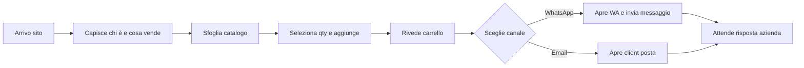

# User journey (F02.03)

Flusso target v1 — ordine senza account.

| Step | Obiettivo utente | Rischio abbandono | Mitigazione |
|------|------------------|-------------------|-------------|
| 1 | Capire trust e prodotto | Non riconosce brand | Hero chiaro, Carpino/Gargano, contatti visibili |
| 2 | Trovare olio/formato | Troppi click | Catalogo flat, prezzi in card |
| 3 | Aggiungere al ordine | UI qty poco chiara | Stepper grande, feedback visivo |
| 4 | Rivedere totale | Dubbio spedizione | Testo "spedizione da concordare" |
| 5 | Inviare | WA non installato | Email + copia testo + tel |
| 6 | Conferma | Crede ordine chiuso | Copy "richiesta da confermare" |
